# Activation de la licence

Cette page décrit la procédure d'activation d'une licence SEABIM Editor à
l'aide de **CodeMeter Runtime** de WIBU-SYSTEMS. Elle s'effectue **une
seule fois**, après l'[installation du plugin](installation.md) et avant
de pouvoir créer un [premier projet](premier-projet.md).

Deux formes de licence coexistent :

- la **licence logicielle**, liée au poste sur lequel elle est activée
  (sections 1 à 5 ci-dessous) ;
- la **licence sur clé USB CmStick**, portée par le dongle et donc
  transférable d'une machine à l'autre (voir
  [Variante : activation sur clé CmStick](#variante-activation-sur-cle-cmstick)).

## Prérequis

- [SEABIM Editor installé](installation.md) et fonctionnel dans CloudCompare.
- CodeMeter Runtime installé sur le poste (voir le tableau Prérequis de la
  page [Installation](installation.md#prerequis)).
- Selon le type de licence : un fichier de licence initial **`.lif`**
  transmis par l'équipe SEABIM, ou la **clé CmStick** fournie par SEABIM.

## 1. Vérifier l'absence de licence active

Une fois SEABIM Editor correctement installé, une icône dédiée apparaît
dans la barre latérale droite de CloudCompare. Tant qu'aucune licence n'a
été activée dans CodeMeter Runtime, un clic sur cette icône affiche le
message d'absence de licence :

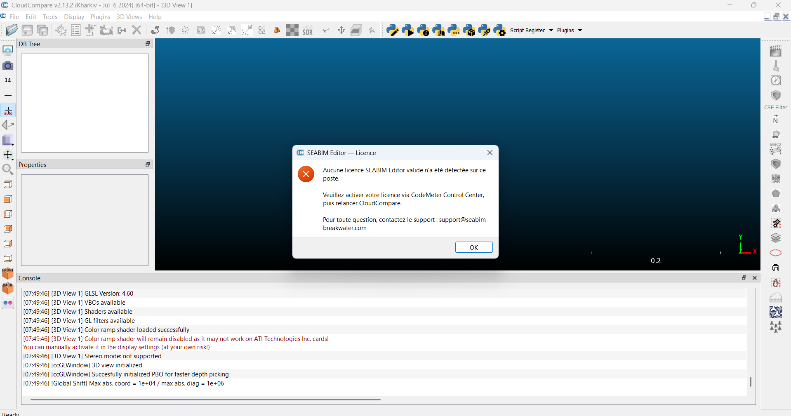

## 2. Importer le fichier `.lif`

1. Enregistrez le fichier `.lif` reçu dans un dossier de votre choix.
2. Ouvrez **CodeMeter Control Center**.
3. Glissez-déposez le fichier `.lif` dans la fenêtre de l'application.

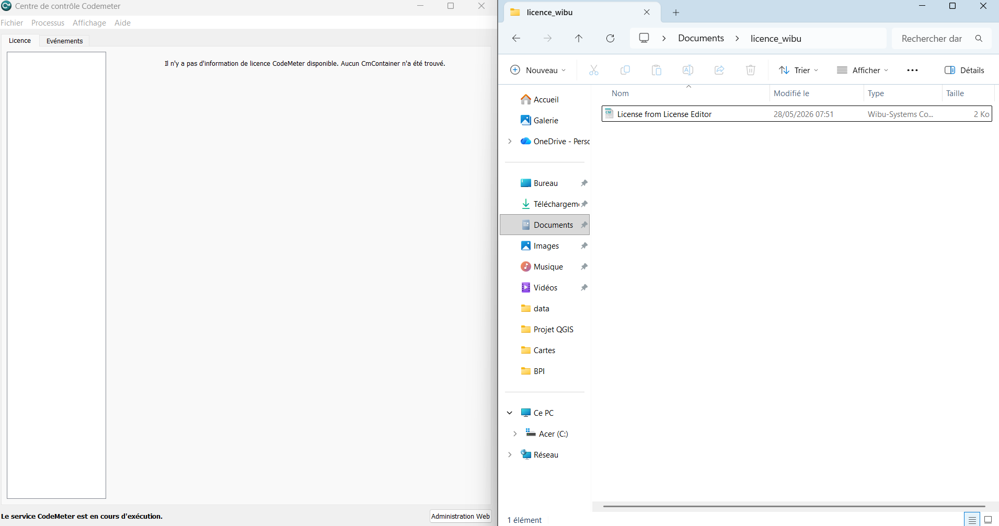

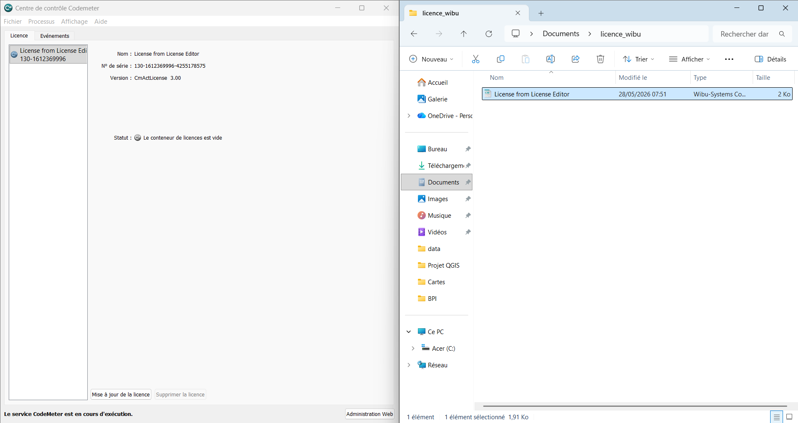

La licence apparaît alors dans la liste : un **CmContainer** vient d'être
créé sur votre poste.

## 3. Demander l'activation de la licence

L'étape suivante consiste à générer une **demande de licence** (fichier
`.RaC`) qui permettra à l'équipe SEABIM d'émettre votre licence
définitive.

1. Dans CodeMeter Control Center, cliquez sur **« Mise à jour de la
   licence »** en bas à droite.
2. Suivez les écrans de l'assistant :

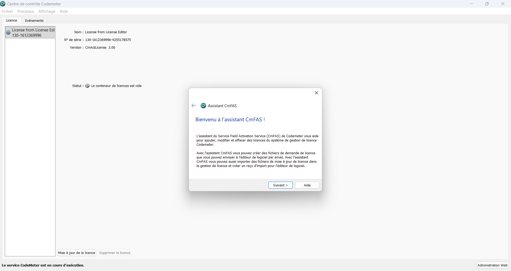

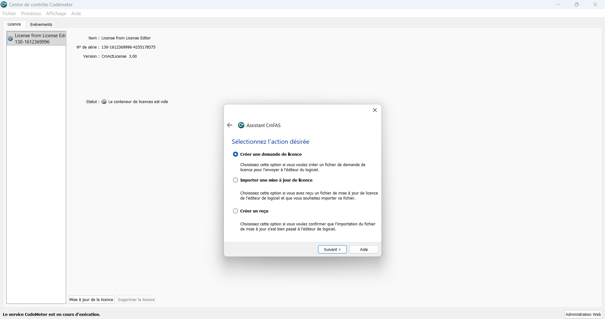

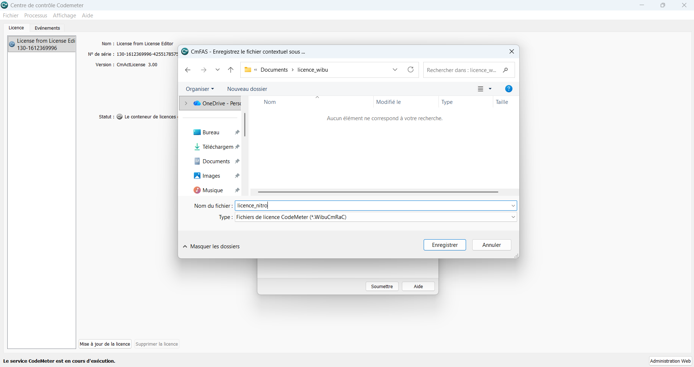

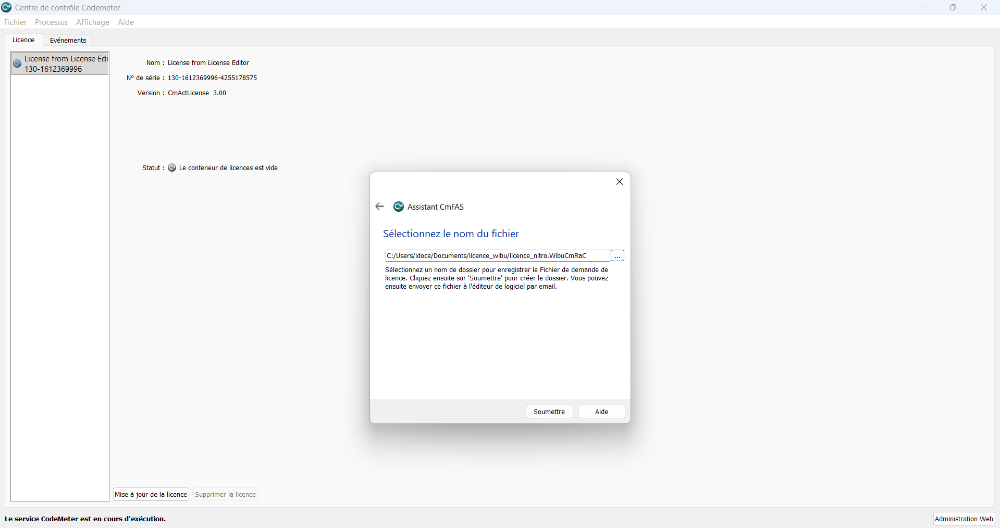

3. Transmettez le fichier **`.RaC`** ainsi obtenu à l'équipe SEABIM.

En retour, vous recevrez un fichier **`.RaU`** à importer dans CodeMeter
Control Center selon la même procédure (glisser-déposer ou via l'assistant
de mise à jour).

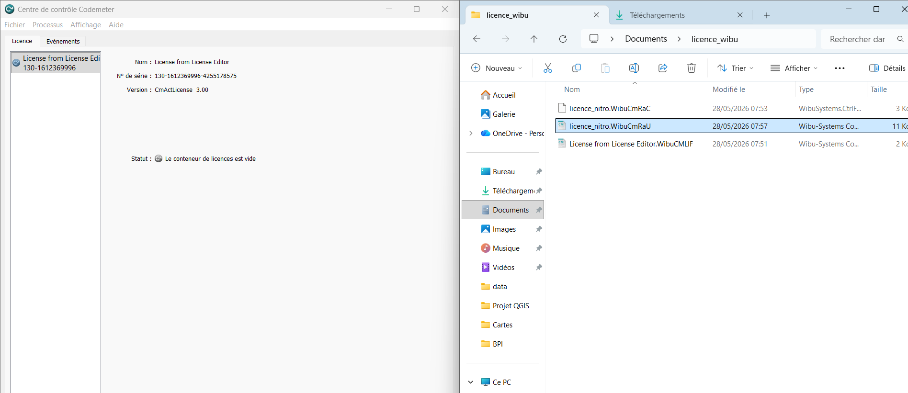

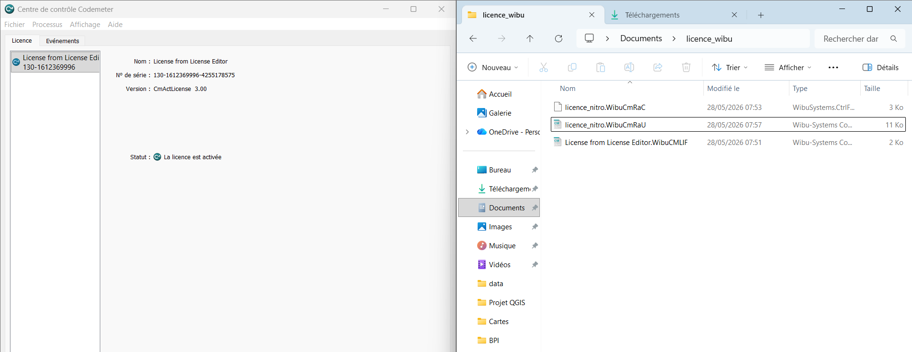

## 4. Vérifier la licence dans CodeMeter WebAdmin

Vous pouvez à tout moment consulter les informations détaillées de votre
licence depuis **CodeMeter WebAdmin** :

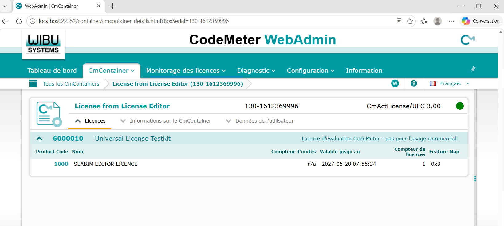

## 5. Valider l'activation dans CloudCompare

Pour finaliser, ouvrez CloudCompare et cliquez sur l'icône **SEABIM** dans
la barre latérale. Une fenêtre récapitulative s'ouvre avec les
informations de votre licence : l'activation est réussie.

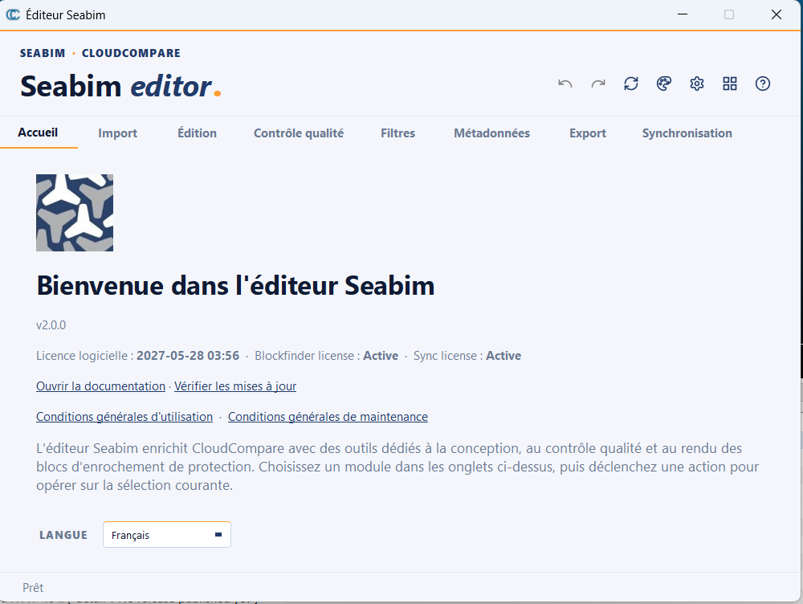

À ce stade, vous pouvez enchaîner sur la création de votre [premier
projet](premier-projet.md).

## Variante : activation sur clé CmStick

La licence peut aussi être portée par une **clé USB CmStick** fournie par
SEABIM, au lieu d'être rattachée au poste. La licence suit alors la clé :
il suffit de brancher le dongle sur une autre machine, CloudCompare et
SEABIM Editor y étant installés, pour y travailler sans nouvelle
activation.

Le principe reste le même (demande `.RaC`, puis mise à jour `.RaU`), avec
deux différences :

- il n'y a **pas de fichier `.lif` à importer** : la clé contient déjà un
  CmContainer vierge ;
- le **Firm Code SEABIM** (`6002880`) doit être saisi manuellement dans
  l'assistant.

### 1. Brancher la clé et ouvrir CodeMeter

Branchez le CmStick sur un port USB, puis ouvrez **CodeMeter Control
Center**. La clé apparaît dans la colonne de gauche sous le nom
**CmStick/B**, suivie de son numéro de série (ici `3-8269754`). Vérifiez
que le statut est bien **Activé**, puis cliquez sur **« Mise à jour de la
licence »**.

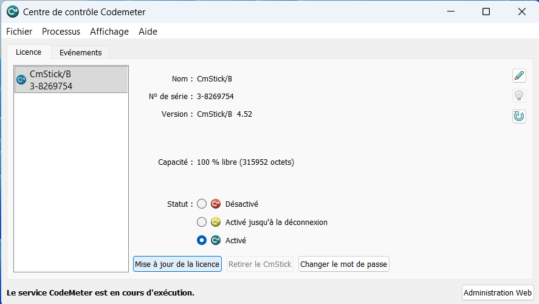

!!! note "Numéro de série"
    Ce numéro identifie votre clé : on le retrouve dans le nom des
    fichiers `.WibuCmRaC` et `.WibuCmRaU` échangés avec l'équipe SEABIM.
    Pensez à le mentionner dans vos échanges avec le support.

### 2. Générer la demande de licence

L'assistant **CmFAS** s'ouvre. Déroulez-le écran par écran :

1. Écran d'accueil de l'assistant : cliquez sur **Suivant**.

    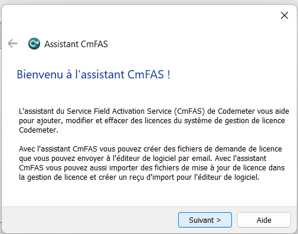

2. Action désirée : sélectionnez **Créer une demande de licence**.

    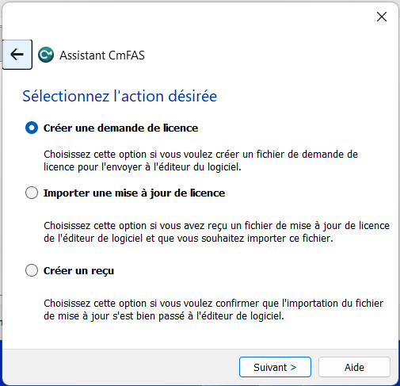

3. Option pour la demande : sélectionnez **Ajouter la licence d'un nouvel
   éditeur**, la clé ne contenant encore aucune licence SEABIM. L'option
   **Étendre la licence courante** ne sert qu'au renouvellement d'une
   licence SEABIM déjà présente sur la clé.

    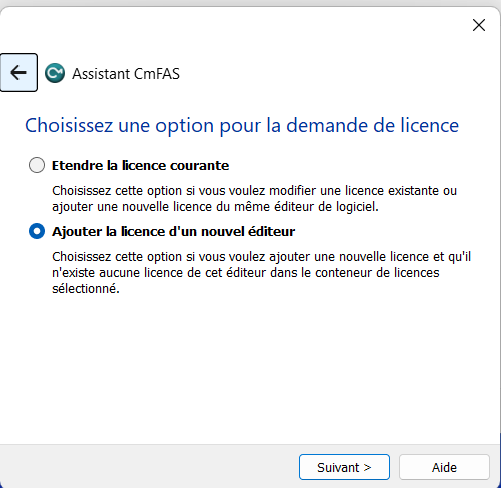

4. Firm Code : saisissez **`6002880`**, le code éditeur de SEABIM.

    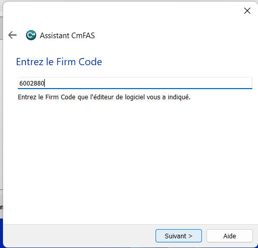

5. Nom du fichier : choisissez le dossier de destination, puis cliquez sur
   **Soumettre**. Le fichier `<n° de série>.WibuCmRaC` y est créé.

    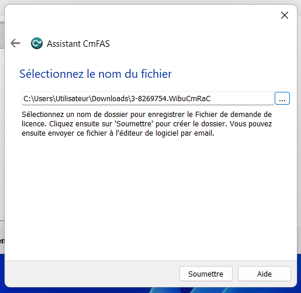

### 3. Transmettre le fichier `.WibuCmRaC`

Ouvrez le dossier choisi à l'étape précédente et transmettez le fichier
`.WibuCmRaC` à l'équipe SEABIM.

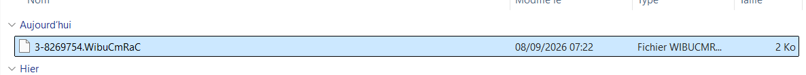

### 4. Importer le fichier `.WibuCmRaU`

En retour, l'équipe SEABIM vous envoie un fichier **`.WibuCmRaU`**.
Enregistrez-le sur le poste, la clé toujours branchée.

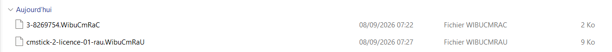

Glissez-le ensuite dans la fenêtre de CodeMeter Control Center, ou
double-cliquez dessus : l'import démarre.

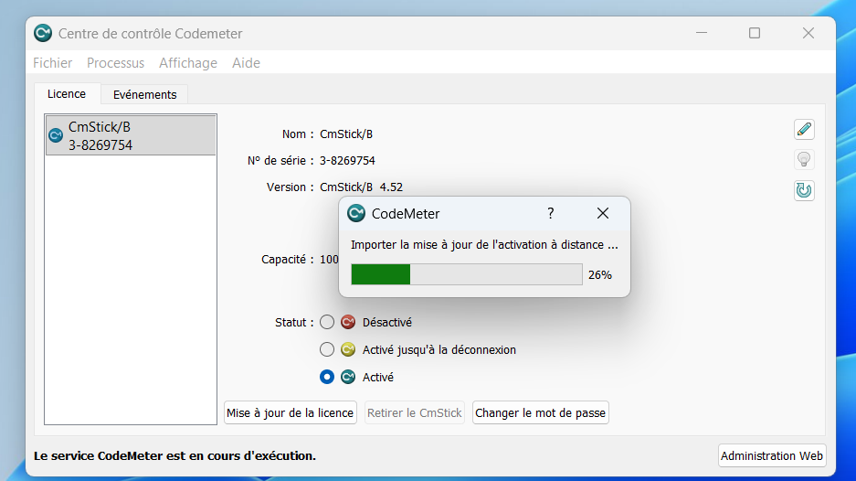

Un message confirme la mise à jour du CmContainer.

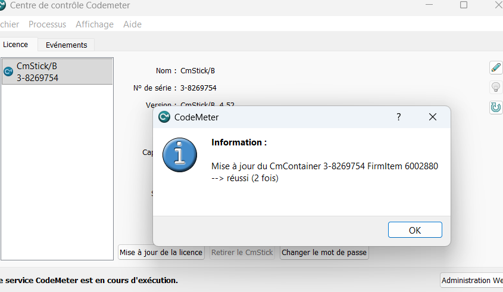

### 5. Vérifier la licence dans CodeMeter WebAdmin

Cliquez sur **Administration Web** en bas à droite de CodeMeter Control
Center, puis ouvrez l'onglet **CmContainer** et sélectionnez votre
CmStick. La licence **SEABIM Editor** doit y figurer, avec son Firm Code
`6002880`, son Product Code `1000` et sa date de validité.

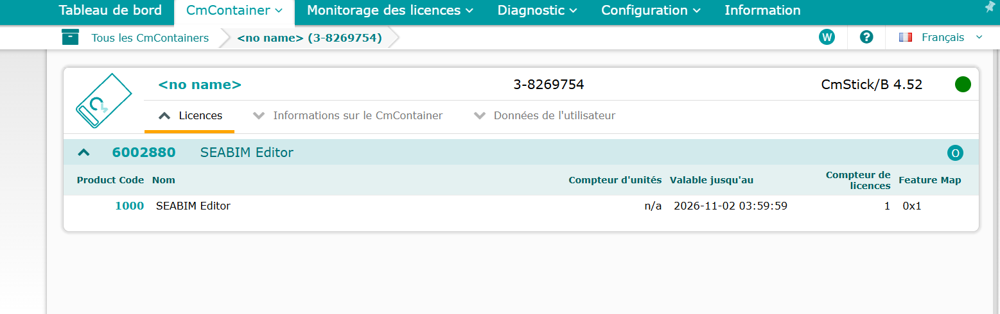

Il ne reste plus qu'à valider l'activation dans CloudCompare, comme à la
[section 5](#5-valider-lactivation-dans-cloudcompare).

!!! warning "La clé doit rester branchée"
    La licence étant portée par le CmStick, celui-ci doit rester connecté
    au poste pendant toute l'utilisation de SEABIM Editor. Retirez-le via
    le bouton **Retirer le CmStick** de CodeMeter Control Center plutôt
    qu'à chaud.

!!! tip "En cas de difficulté"
    Conservez précieusement les fichiers `.lif`, `.RaC` et `.RaU` (ou
    `.WibuCmRaC` et `.WibuCmRaU`), et contactez le support SEABIM en
    joignant une capture du message d'erreur affiché par CodeMeter Control
    Center ou par le launcher SEABIM Editor.
