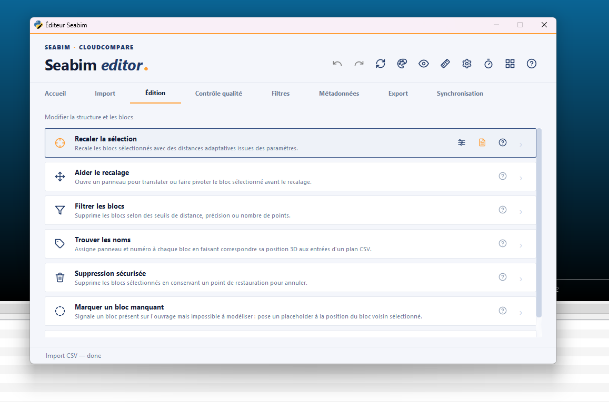
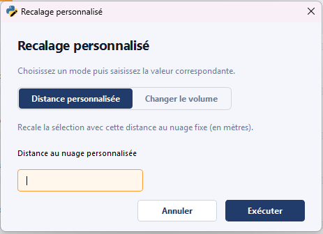
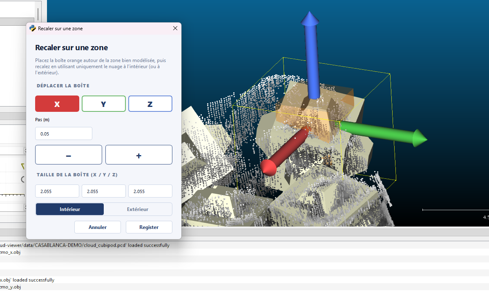
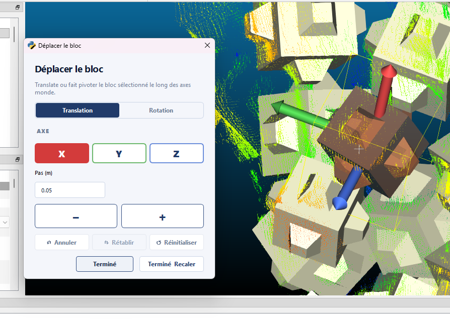
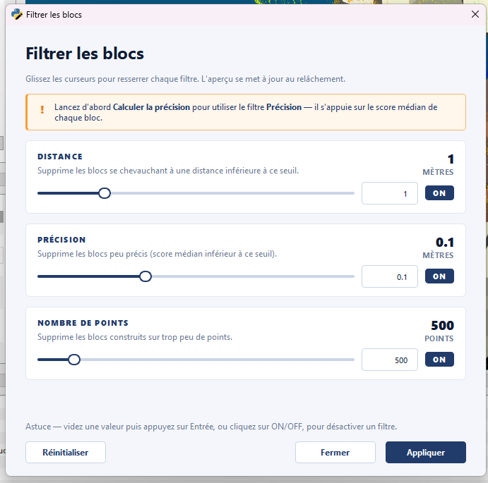
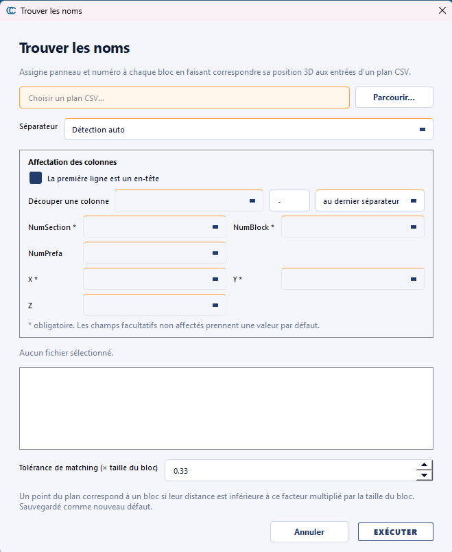
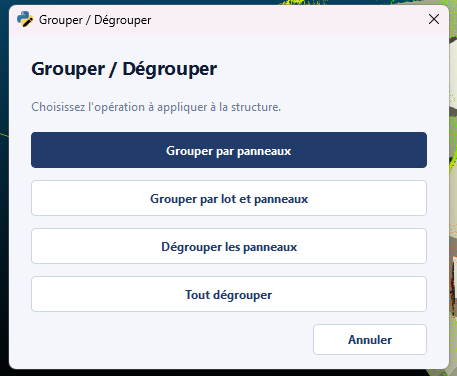

# Edit

The **Edit** module groups the structure editing actions: registration of
blocks on the reference cloud, threshold-based filtering, safe deletion,
grouping by panel or package, and assignment of plot numbers from a
placement plan.

This is the tab where the **correction and refinement** work happens
once a structure has been loaded (from JSON) or detected automatically
(via [`Find blocks in a point
cloud`](input.md#find-blocks-in-a-point-cloud)).

## Register selection { #register-selection---adaptive-dist }

**Shortcut: ++ctrl+e++**

Realigns (registration) the selected blocks on the reference point cloud.
Each block is adjusted independently to minimise its distance to the cloud.
Use after automatic detection or after manually moving a block, to refine its
position.

Everything goes through **a single button**: by default it registers using
**adaptive distance**, and its **small sliders icon** gives access to two
custom modes. A **`Registration report` badge** rounds out the action.

### "Registration report" badge

To the right of the button:

- **Enabled**: a report detailing the moves (translations, rotations, scores)
  opens automatically at the end of each registration.
- **Disabled**: no pop-up; clicking the badge re-enables it and shows the last
  report produced in this session.

### Registration modes

The **small sliders icon** next to the button does not register on its own: it
**configures the mode** that `Register selection` (++ctrl+e++) will then apply.

| Mode                  | Effect                                                                                                                                       |
| --------------------- | ------------------------------------------------------------------------------------------------------------------------------------------- |
| **Adaptive distance** | Default mode. **Adaptive** cloud distances, defined in the project parameters.                                                              |
| **Custom distance**   | Registers with a **fixed cloud distance** instead of the adaptive distances. **Persistent** override for the session.                       |
| **Zone registration** | Registers using only a **small portion of the cloud** delimited by a box (see below).                                                       |

In **Custom distance** mode, the entered value is remembered for the session:
the icon stays **orange** and each `Register selection` reapplies the mode
without re-entering it. Selecting "clear" in the dialog goes back to the
adaptive mode.

### Zone registration { #register-selection---zone }

**Zone registration** restricts the adjustment to a **portion of the cloud**
rather than to all the points around the block. This is useful when only part
of the cloud is reliable (noisy zone, parasitic neighboring blocks, interface
between two surveys).

When you pick this mode, a **dedicated panel** opens and spawns a **box** in
the CloudCompare scene:

1. Position and size the box around the portion of cloud to keep (or to
   exclude).
2. Choose to keep the cloud **inside** or **outside** the box.
3. Confirm: registration only considers the retained points. The crop
   distance stays **adaptive**.

Unlike the custom distance, zone registration **is not a persistent
override**: the box is spatial and placed by hand on each use.

## Change volume { #change-volume }

**Assigns a new volume** to the selected blocks, along with the matching size,
then registers them. Useful when two neighboring volumes were confused during
detection (e.g. 2 m³ vs 3 m³).

The dialog asks for the new volume, in m³ (in cm³ with a LAB licence). The
change only applies to the selection, and only once: later registrations keep
each block's volume. A checkpoint is taken before the operation, so it can be
undone like the others.

## Help register { #help-register }

Opens an interactive panel that lets you **translate or rotate** the
selected block before running the registration. Useful when a block's
starting position is too far from the cloud for the automatic
registration to converge.

Typical workflow:

1. Select the block to pre-position.
2. Click `Help register`.
3. Use the arrows / sliders to move the block close to its theoretical
   position on the cloud.
4. On validation, the [`Register selection - Adaptive
   dist`](#register-selection---adaptive-dist) action is run
   automatically.

## Fit position { #fit-position }

**Shortcut: ++ctrl+f++**

Searches for the **best pose and orientation** of the selected blocks
against the cloud. Where [`Register
selection`](#register-selection---adaptive-dist) starts from the current
pose and refines it locally (ICP), this action **explores**: it samples
poses within a search radius around the block and keeps the best one
according to a criterion that weighs together

- the **distance to the cloud** (median point-to-block distance);
- the **non-overlap with neighbours**: a block cannot sit inside another
  block's material;
- the **exposed surface with no points**: an upward-facing facet that no
  neighbour masks must carry points, otherwise the pose exposes material
  where the survey measured nothing.

It therefore recovers **orientation errors** that a local registration
cannot undo, at the cost of about fifteen seconds per block.

Blocks are processed one by one, and each one constrains the next. The
launcher progress bar shows the current block; `Cancel` stops the series and
**the blocks already fitted are kept**.

### "Deep search" button

The **magnifier icon** to the right of the button switches the search budget
(`fit_deep_search` parameter):

| State             | Budget                                        | When to use it                                                                  |
| ----------------- | --------------------------------------------- | ------------------------------------------------------------------------------- |
| Grey (default)    | Quick search, about **15 s per block**        | Standard case.                                                                  |
| Orange            | Deep search, about **80 s per block**         | Blocks the quick search fails to place, or a very uncertain starting pose.       |

The setting is kept across sessions, like the custom registration of `Register
selection`. Beyond 20 selected blocks, a confirmation dialog states the cost of
the operation.

### Fit report

When the computation ends, a dialog gives **one line per block**: applied
displacement and rotation, resulting median, share of exposed surface without
points. Blocks above `fit_alert_median` or `fit_alert_visible` are marked with
a ⚠ and listed first. The whole selection is listed: past a dozen blocks the
list scrolls.

The **report badge** (the icon to the right of the button) turns the automatic
display off; turning it back on replays the last report of the session, as for
`Register selection`. The per-search detail stays in the console (`[FIT]`
lines), for diagnostics.

Blocks are recolored on `median_score` when the action completes, and a
checkpoint lets you undo the whole operation ( ++ctrl+z++ ).

### Settings { #fit-settings }

All of these are editable from the **Preferences** (or directly in
`parameters.json`). Two families:

- names ending in `_rel` are **proportions of the block size**: they follow the
  entered volume, the working unit (feet) and laboratory mode on their own,
  with nothing to change;
- the others are absolute lengths in metres, converted to the cloud unit at
  run time, except `fit_visible_weight`, a pure number.

| Parameter | Default | Effect | When to change it |
| --------- | ------- | ------ | ----------------- |
| `fit_search_radius_rel` | 0.25 | Radius of the translation search box, as a proportion of the block size (0.60 m for a 2.4 m block). | Only when the starting pose is wrong **beyond** that radius, and then together with the deep search. The volume to explore grows as the cube of the radius: at a constant budget, widening it degrades the result (32 blocks out of 36 replaced at 0.25, against 24 out of 36 at 0.40). |
| `fit_max_angle` | 180 | Half-width of the rotation search, in degrees. 180 sweeps every possible orientation. | Lower it (30 for instance) to correct the position only, when the current orientation is already trusted. |
| `fit_cloud_dist_rel` | 0.125 | Distance beyond which a cloud point no longer describes the block (0.30 m for a 2.4 m block). | Tuned together with `fit_visible_weight` (0.125 with 3): a tighter distance sharpens the optimum, the exposed-surface term keeps the search from losing it. Tighten it on a very clean survey, loosen it on a noisy cloud or a poorly separated layer, and keep the pair together: 0.40 degrades, 0.10 collapses the search. |
| `fit_visible_weight` | 3 | Weight of the "exposed surface with no points" term. The term is the mean distance between the exposed facets and the cloud, clipped at 0.042 x block size, so it is a length like the cloud distance and this weight is a pure number that holds at every scale. | **0 disables it**: the criterion is then the cloud distance and the non-overlap alone. This is the first setting to try when blocks that were already well placed flip over. Below 1.5 the search loses its basin of attraction (more blocks left at a wrong pose); between 2 and 5 the result is flat; past 5 the term overwhelms the cloud distance. |
| `fit_coverage_min` | 0.05 | Minimum fraction of the block surface that must carry points. A guard rail against degenerate poses, not a target: a survey seen from above only lights part of a block. | Rarely. Raise it only if blocks settle into empty space. |
| `fit_n_sample` | 150 | Number of points sampled on the block surface to measure the overlap with its neighbours. | Raise it (300) on a heavily interlocked armour layer; the cost is linear. |
| `fit_alert_median` | 0.10 m | Median above which the report flags the block with a ⚠. | Match it to the survey quality. No effect on the computation, only on how the report is sorted. |
| `fit_alert_visible` | 0.50 | Same role, on the share of exposed surface without points. | Same. |
| `fit_deep_search` | 0 | Search budget. | From the magnifier icon rather than from here. |
| `show_fit_report` | 1 | Automatic report display. | From the report badge rather than from here. |

The `_rel` thresholds are measured against the **physical block size**
(`block_size`), not against the cube root of its volume: for a 3 m³ Coreloc the
former is 2.39 m and the latter 1.44 m.

### Laboratory mode { #fit-lab }

The criterion is **homogeneous to a length**: every one of its terms follows
the cloud scale, so the defaults above hold in metres, in feet and on a scale
model alike. Two things to keep in mind:

- `lab_tolerance_factor` (2.0 by default) loosens the **measurement**
  tolerances in laboratory mode, because scanner noise does not shrink with the
  model. It drives the counting distance and the grid resolution of the exposed
  surface term. It is the first setting to adjust if the fit feels jumpy on a
  scale model.
- The report shows **two more decimals** in laboratory mode: at that scale,
  displacements are counted in tenths of a millimetre.

### Diagnostics { #fit-diagnostics }

The console keeps one `[FIT]` line per block: median and criterion value before
and after, number of generations, computation time. Two more indicators are
written on the block and readable from
[`Show metadata`](metadata.md#show-metadata-block), under "Other":

- `visible_uncovered`: share of the exposed surface the survey did not
  instrument, that is the `Exposed` column of the report;
- `restart_agreement`: share of the independent searches that converged to the
  pose that was kept. 1.0 means they all agree; a low value flags a result
  worth replaying, with the deep search if needed.

## Filter blocks { #filter-blocks }

Removes blocks that do not meet quality thresholds: **median distance**
to the cloud, **accuracy**, or **point count** of correspondence.

Dialog parameters:

| Parameter            | Description                                                                                                                                                |
| -------------------- | ---------------------------------------------------------------------------------------------------------------------------------------------------------- |
| `Score threshold`    | Upper threshold on the median of point distances around the block, in meters. Blocks whose score exceeds the threshold are removed.                        |
| `Distance threshold` | Threshold on the distance between block centers, in meters. If two blocks are closer than this threshold, the one with the lowest median distance is kept. |
| `Accuracy threshold` | Threshold on accuracy (quality scalar field). Blocks below are removed.                                                                                    |

!!! tip "First filtering after detection"
    This action is typically used right after automatic detection to
    eliminate false positives before manual registration.

## Find names { #find-names }

Assigns the **plot and block numbers** of the blocks by matching each
block's 3D position to a **placement plan** in CSV format.

Dialog parameters:

| Parameter                        | Description                                                                                                                                                                       |
| -------------------------------- | --------------------------------------------------------------------------------------------------------------------------------------------------------------------------------- |
| `Browse…`                        | The placement plan CSV used to name the blocks.                                                                                                                                   |
| `Separator`                      | `Auto` (auto-detection), `,`, `;`, tab or pipe.                                                                                                                                   |
| `First row is a header`          | Guessed when the file is opened. Unchecked, the first row is read as data and the columns are named `a1`, `a2`, …                                                                 |
| `Split a column`                 | Splits a column on a separator (`-` by default), at the last or the first one. Both parts become columns you can assign.                                                           |
| `Column mapping`                 | Each expected field gets a column of the plan. `NumSection`, `NumBlock`, `X` and `Y` are required; `Z` enables 3D matching and `NumPrefa` fills the prefab number.                 |
| `Match tolerance (× block size)` | A plan point matches a block if their distance is less than this factor times the block size. The value is saved as the new default.                                               |

The mapping is guessed from the headers whatever their order and stays editable by
hand. The preview shows the values as they will be read, and `Run` stays disabled
until every required field has a column. Blocks that no plan point reaches within
the tolerance are named `Unknown_xx`.

!!! note "Plan without a header, or concatenated block name"
    A plan whose first row is already data, or whose single column carries both the
    section and the block number (`P12-A-01`), is read without prior editing: uncheck
    `First row is a header`, split the column on `-` at the last separator, then
    assign `P12-A` to `NumSection` and `01` to `NumBlock`.

## Safe delete { #safe-delete }

**Shortcut: ++ctrl+d++**

Removes the selected blocks while keeping an **undo checkpoint**. Unlike
direct deletion via CloudCompare (++del++), this action lets you roll back via the
[`Undo`](header.md#undo) button of the [Header](header.md).

## Mark missing block { #mark-missing-block }

Flags a block that **exists physically on the structure but cannot be
modelled** from the point cloud (missing or insufficient data). Because
CloudCompare does not expose 3D picking in the viewport, the position is
taken from a **neighbouring block**:

1. Select the existing block closest to the gap.
2. Click `Mark missing block`.
3. A red **placeholder** (block type `Missing`) is created at that
   block's position.
4. Reposition it over the actual gap with CloudCompare's native
   transformation tool — the new position is read back automatically.

Placeholders are excluded from quality computations (accuracy,
differential, overlap, density), from registration, and from the
placement exports: they only record the gap. They are synchronised to the
cloud viewer through their `Missing` type, so completeness statistics can
account for them, and they show up under **Missing** in
[`Display by type`](header.md#display-by-type). To remove a misplaced placeholder, use
[`Safe delete`](#safe-delete).

## Group / Ungroup { #group--ungroup }

Reorganises the display of the structure in CloudCompare's tree by
**grouping** blocks by panel or package, or **ungrouping** existing
groups.

A single dialog exposes the 4 operations:

| Operation         | Effect                                                                  |
| ----------------- | ----------------------------------------------------------------------- |
| `Group panels`    | Groups blocks sharing the same `plot_number` into a `panel` subgroup.   |
| `Ungroup panels`  | Splits panel groups and moves the blocks back to the top level.         |
| `Group packages`  | Groups blocks sharing the same `package`.                               |
| `Ungroup all`     | Splits every grouping (panel + package).                                |

