# Filtres

Le module **Filtres** calcule des **filtres géométriques de contrôle de
pose** sur la structure courante. Chaque action produit un **champ
scalaire** sur les blocs, qu'on peut visualiser via l'action [`Changer
l'échelle de couleurs`](header.md#change-color-scale) du
[Header](header.md).

L'onglet est affiché en **grille** (11 boutons) plutôt qu'en liste, pour
faciliter la sélection rapide d'un filtre.

!!! tip "Visualiser un filtre"
    Après calcul d'un filtre, ouvrir l'action [`Changer l'échelle de
    couleurs`](header.md#change-color-scale) (++ctrl+l++) et sélectionner
    le nom du filtre dans la liste des champs scalaires pour appliquer une
    coloration sur les blocs.

## Hors profil { #out-profile }

Calcule la **distance de hors profil** : distance d'un bloc au plan moyen
formé par les blocs adjacents. Permet de repérer les blocs trop en
saillie ou trop en retrait par rapport à leurs voisins.

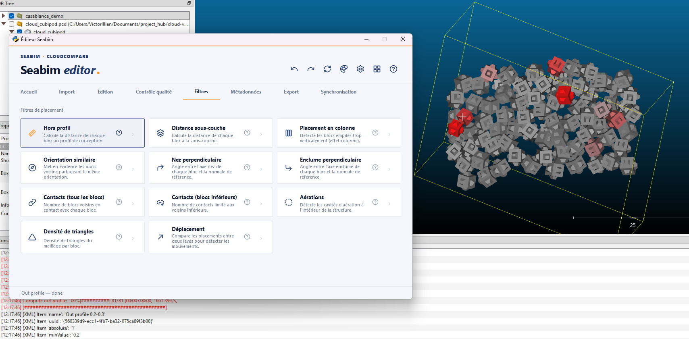

## Distance sous-couche { #underlayer-distance }

Calcule la **distance** entre chaque bloc et la **surface sous-jacente**
(sous-couche). Utile pour vérifier que les blocs reposent correctement sur
la couche inférieure de la digue.

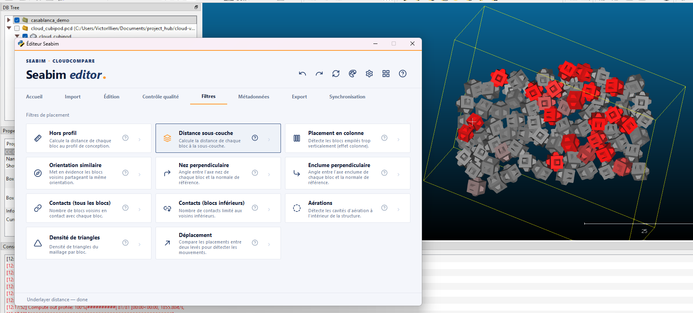

## Placement en colonne { #column-placement }

Met en avant les **couples de blocs voisins empilés verticalement** l'un
au-dessus de l'autre. Une pose en colonne est un défaut : les efforts ne se
répartissent pas correctement entre les couches.

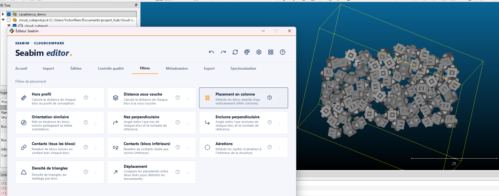

## Orientation similaire { #similar-orientation }

Met en avant les **couples de blocs voisins partageant la même
orientation**. Une orientation trop homogène entre voisins immédiats peut
être un défaut de pose (l'alternance d'orientations participe à la
stabilité).

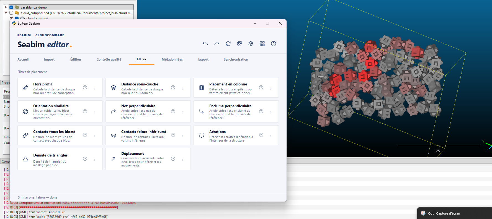

## Nez perpendiculaire { #perpendicular-nose }

Calcule l'**angle entre l'axe « nez » de chaque bloc et la normale au
talus de référence**. Permet de vérifier que les nez de blocs sont
orientés perpendiculairement au talus (orientation théorique optimale).

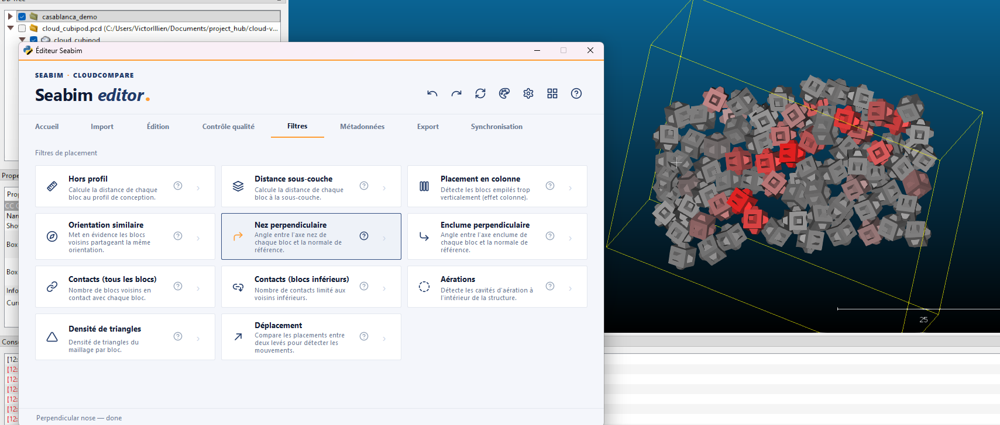

## Enclume perpendiculaire { #perpendicular-anvil }

Identique à [`Nez perpendiculaire`](#perpendicular-nose) mais sur l'**axe
« enclume »** du bloc.

La valeur **0 correspond à une enclume perpendiculaire à la pente**, et
**sous 30° le bloc devient rouge**. Cette configuration, lorsqu'elle se
répète, peut entraîner un déséquilibre des autres blocs : au-delà d'un
certain pourcentage de blocs rouges, la structure est dans une mauvaise
position pour la suite. C'est donc la **part de blocs rouges** qui compte,
pas le bloc isolé.

**Réservé à l'Accropode I.** Seul ce type de bloc porte une enclume
identifiable dans son repère propre : sur un Xbloc ou un Cubipode, le
même calcul rendrait un angle parfaitement calculable qui ne mesure rien.
Les blocs d'un autre type sont donc écartés du calcul, et le filtre
refuse de tourner si la sélection n'en contient aucun. Sur une structure
mixte, seuls les Accropode I sont mesurés et le rapport indique ce qui a
été laissé de côté.

Les pourcentages au-dessus et en dessous de 30° restent lisibles dans la
console CloudCompare. À la fin du calcul, un **rapport statistique** les
reprend et les complète : blocs mesurés et blocs écartés, part de blocs
rouges et part au-dessus de 30°, ventilation de ces blocs rouges aux
paliers 10°, 15° et 20° (à part égale, des enclumes à 28° et des enclumes
à 5° ne décrivent pas la même structure), puis moyenne / médiane / 10e
percentile / minimum de l'angle et répartition par tranches de 5°. Le 10e
percentile et le minimum plutôt que leurs symétriques : ici c'est la queue
basse de la distribution qui porte l'information.

Le rapport reste agrégé ; pour retrouver un bloc en particulier, on passe
par le champ scalaire `perpendicular_anvil` ou l'export CSV, qui portent
le détail bloc par bloc. Le palier mis en avant dans la ventilation est
réglable dans les Préférences (`anvil_angle_threshold`, 30° par défaut,
soit le seuil du rouge) ; le baisser affine la lecture sans déplacer le
rouge, qui suit l'échelle de couleur. Le rapport peut être coupé ou
réaffiché via la pastille à droite du bouton (`show_anvil_report`).

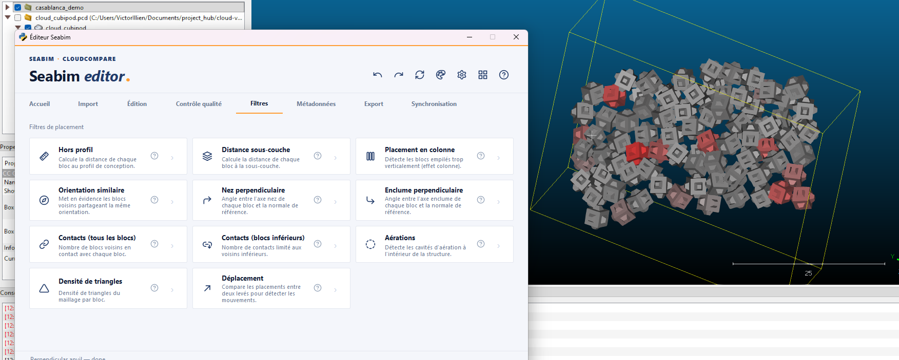

## Contacts (tous les blocs) { #contacts-all-blocks }

Calcule le **nombre de blocs en contact** avec chaque bloc. Un bloc en
contact avec trop peu de voisins est mal stabilisé ; un nombre élevé peut
indiquer une zone trop dense.

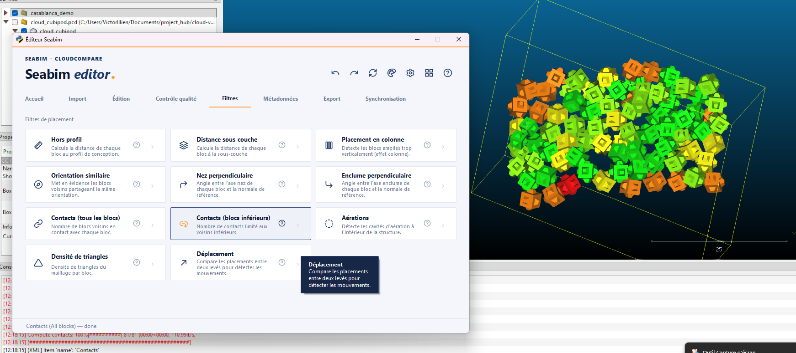

## Contacts (blocs inférieurs) { #contacts-inferior-blocks }

Variante de [`Contacts (tous les blocs)`](#contacts-all-blocks) qui
restreint le décompte aux **blocs situés en couche inférieure**. Permet
d'isoler les appuis structurels sans bruit lié aux blocs latéraux ou
supérieurs.

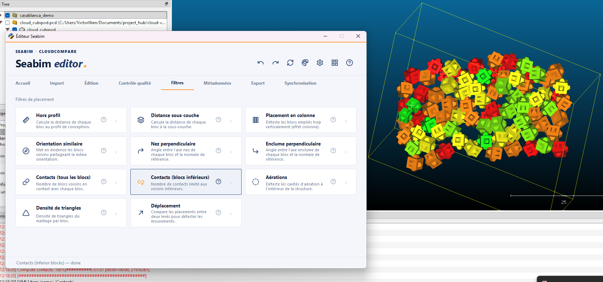

## Aérations { #voids }

Détecte les **cavités d'aération** à l'intérieur de la structure : zones
où l'absence de blocs crée un vide non prévu par le design.

Le calcul raisonne par **groupe de trois blocs voisins** : pour chacun,
SEABIM mesure la **plus grosse sphère qui tient entre eux** sans toucher la
géométrie. Une sphère est déposée au cœur de chaque vide dont le diamètre
tombe entre les deux bornes, et l'ensemble forme un groupe nommé
**Vides (diamètre min …)** dans l'arbre CloudCompare.

La modale **Calculer les aérations** propose les réglages suivants, tous
exprimés en **diamètre**, dans l'unité de travail :

- **Diamètre minimal des vides** : diamètre de la plus petite sphère qui
  doit tenir dans un vide pour qu'il soit signalé. L'abaisser détecte des
  vides plus serrés — donc davantage de résultats, dont certains ne sont
  que des irrégularités de surface.
- **Diamètre maximal des vides** : les vides plus larges sont ignorés.
  Au-delà d'une certaine taille, c'est le bord de l'ouvrage ou une zone non
  levée qui apparaît, pas un défaut de pose.
- **Nombre de points d'échantillonnage** : nombre de points testés dans
  chaque cellule pour trouver l'endroit le plus dégagé. Plus de points
  donne une détection plus fine, et un calcul plus long.

!!! tip "Options avancées"
    Les deux derniers réglages sont masqués derrière le bouton **Afficher
    les options avancées** : ils se règlent en général une fois par
    chantier, alors que le diamètre minimal se réajuste à chaque passe.

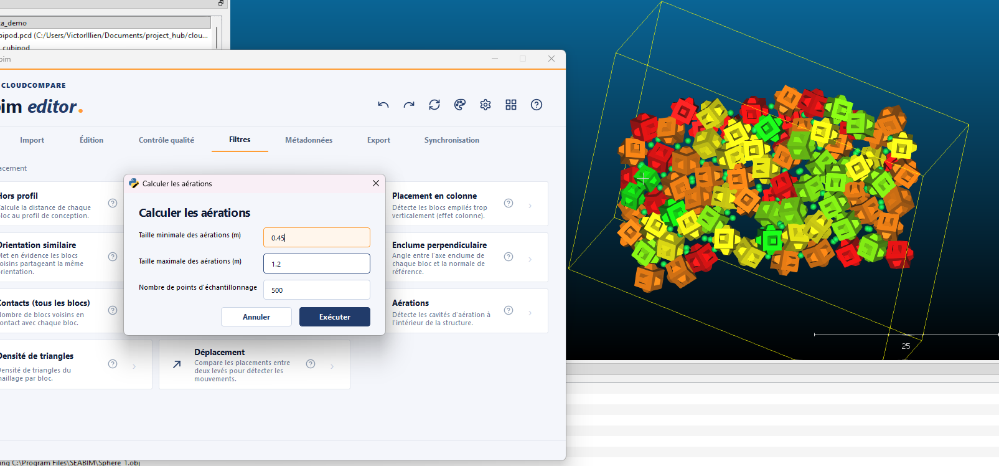

## Densité de triangles { #triangle-density }

Calcule la **densité de triangles du maillage** par bloc. Métrique de
contrôle : un bloc dont la densité de triangles s'écarte fortement de la
moyenne signale souvent un problème géométrique (bloc déformé, mauvais
type).

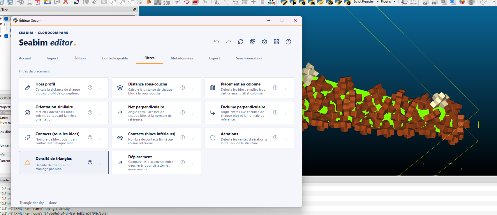

## Déplacement { #displacement }

Calcule le **déplacement** des blocs par rapport à une **structure de
référence** (typiquement le levé précédent), pour repérer les mouvements
entre deux campagnes. La modale **Calculer le déplacement** propose les
réglages suivants :

- **Taille minimale des flèches** et **Valeur maximale du déplacement**
  (relatives à la taille des blocs) : pilotent uniquement la **coloration
  initiale** et la couleur des flèches affichées dans la vue.
- **Échelle de référence** : choisit l'unité dans laquelle le déplacement
  est rapporté pour la coloration.
    - **Absolu** : valeur brute, dans l'unité de travail.
    - **H (taille de bloc)** : déplacement rapporté à la **hauteur
      caractéristique** du bloc (ratio sans dimension).
    - **DN (diamètre nominal)** : déplacement rapporté au **diamètre
      nominal** du bloc (racine cubique de son volume).
- **Méthode d'appariement** : comment associer chaque bloc courant à son
  homologue de la structure de référence.
    - **distance** : par proximité spatiale.
    - **section et numéro** : par identité (même section + même numéro de
      bloc).

!!! note "Le déplacement est stocké en valeur absolue"
    L'échelle choisie ici ne fixe que la coloration et les flèches
    initiales. Le déplacement est conservé en **valeur absolue** sur les
    blocs : **H** et **DN** ne sont que des **vues** recalculées à la
    volée. On peut donc rebasculer vers n'importe quel champ ou échelle via
    [`Changer l'échelle de couleurs`](header.md#change-color-scale) — ou
    [exporter](output.md) dans un autre référentiel — **sans relancer le
    calcul**.

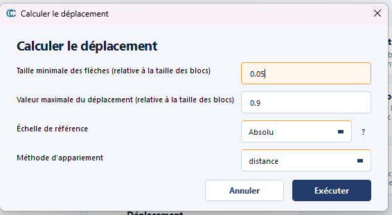
