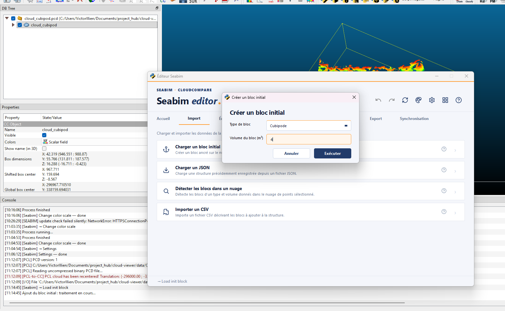
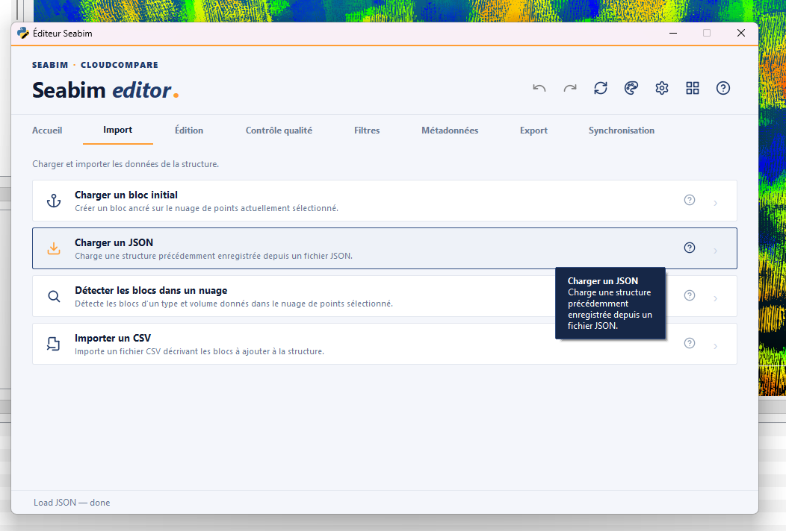
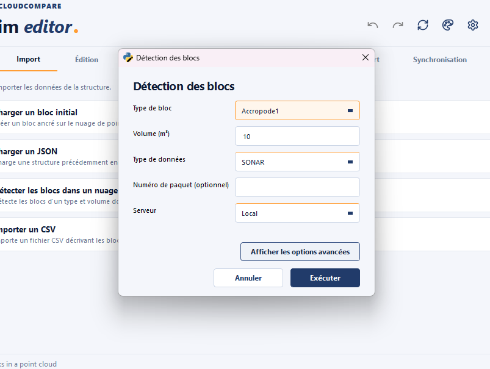
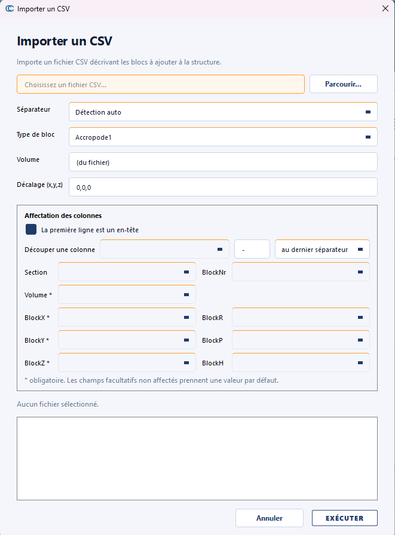

# Import

Le module **Import** regroupe les actions de **chargement** de structures :
création d'un bloc initial à partir d'un nuage, ouverture d'un fichier
JSON, détection automatique de blocs et import depuis un CSV externe.

C'est typiquement le premier onglet utilisé en début de session.

!!! info "Disponibilité des actions"
Certaines actions sont conditionnées par la licence WIBU :
`Détecter les blocs dans un nuage` n'apparaît que si le bit
BlockFinder est actif dans la Feature Map du client.

## Charger un bloc initial { #load-init-block }

Crée un **bloc d'amorçage** ancré sur le nuage de points actuellement
sélectionné dans CloudCompare. Ce bloc sert de référence pour les
opérations ultérieures (positionnement, recalage manuel, etc.).

Utiliser cette action quand on travaille **sans détection automatique** :
on positionne d'abord un bloc unique sur le nuage, puis on duplique et
recale chaque bloc voisin un à un via [`Aider le recalage`](edit.md#help-register) et
[`Recaler la sélection - Distance adaptative`](edit.md#register-selection---adaptive-dist).

C'est aussi l'action utilisée pour **démarrer un projet sans licence
BlockFinder** : on construit la structure manuellement à partir d'un seul
bloc de référence.

## Charger un JSON { #load-json }

Ouvre un fichier de structure JSON précédemment sauvegardé (voir
[`Sauvegarder un JSON`](output.md#save-json)).

C'est l'action utilisée pour **reprendre un projet** : on récupère le
dernier JSON livré (suffixe `_find`, `_filtered`, `_manual_n` selon le
jalon — cf. [Nomenclature des structures](../workflow/formats-fichiers.md#json-naming))
et on continue le travail là où il s'était arrêté.

!!! tip "Sauvegarde automatique"
Si la session précédente s'est mal terminée (crash CloudCompare,
extinction brutale), le launcher conserve un `autosave.json` dans le
dossier de données utilisateur. Le lien **Restaurer la dernière
sauvegarde automatique**, sur la page d'accueil, le recharge
directement — inutile d'aller le chercher via *Charger un JSON*.
Ce fichier est réécrit au maximum toutes les 100 secondes, et
uniquement après une modification de la structure : il peut donc être
légèrement antérieur à l'incident.

## Détecter les blocs dans un nuage { #find-blocks-in-a-point-cloud }

Détecte automatiquement les blocs d'un **type et d'un volume donnés** dans
le nuage de points sélectionné. La structure produite peut ensuite être
nettoyée via [`Filtrer les blocs`](edit.md#filter-blocks) et affinée par
[`Recaler la sélection - Distance adaptative`](edit.md#register-selection---adaptive-dist).

C'est le point d'entrée du workflow de **reconstruction automatique**
décrit dans la [procédure courante § Reconstruction automatique](../workflow/procedure-courante.md#auto-reconstruction).
Plusieurs détections peuvent tourner en parallèle dans des fenêtres
CloudCompare distinctes pour traiter différentes zones simultanément.

!!! tip "Bonnes pratiques de détection" - Lancer la détection sur un nuage **découpé en zones de 500 m
maximum** (cf. [découpage des nuages](../workflow/procedure-courante.md#cutting))
pour limiter le temps de calcul et faciliter le traitement par lots. - Toujours appliquer un [`Filtrer les blocs`](edit.md#filter-blocks) juste après la détection pour éliminer les faux positifs avant le recalage manuel.

!!! warning "Action gardée par licence"
Cette action n'est disponible que si la licence du poste inclut le
feature **BlockFinder**. En l'absence de ce droit, le bouton
n'apparaît pas dans l'onglet Import.

## Importer un CSV { #import-csv }

Importe un fichier CSV décrivant les blocs à ajouter à la structure.

Utile pour **injecter une liste de positions issue d'un outil externe**
(plan de pose théorique, export d'un autre logiciel, fichier produit par
un script métier) sans repasser par la détection automatique. Les blocs
créés sont placés aux positions du CSV ; leur recalage fin sur le nuage
reste à faire via le module [Édition](edit.md).

La modale d'import facilite la lecture de fichiers hétérogènes :

- **Choix du séparateur** : `Auto` (détection automatique), `,`, `;`,
  tabulation ou barre verticale. Le mode `Auto` analyse les premières lignes
  pour deviner le bon séparateur.
- **Affectation des colonnes** : chaque champ attendu par l'éditeur reçoit une
  colonne du fichier. L'affectation est devinée à partir des en-têtes, quel que
  soit leur ordre, et reste modifiable à la main pour un fichier dont les
  colonnes portent d'autres noms.
- **Première ligne** : la case `First row is a header` est cochée ou non selon ce
  que contient le fichier. Décochée, la première ligne est lue comme une donnée et
  les colonnes sont nommées `a1`, `a2`, …
- **Découpage d'une colonne** : une colonne qui concatène deux champs se coupe sur
  un séparateur (`-` par défaut), au dernier ou au premier. Les deux morceaux
  s'ajoutent à la liste des colonnes affectables.
- **Volume** : quand le fichier ne porte aucune colonne de volume, la valeur
  saisie ici s'applique à tous les blocs, au même titre que le type de bloc.
  C'est le cas d'un export VOSS.
- **Aperçu interprété** : les premières lignes du fichier sont affichées
  telles qu'elles seront lues, pour vérifier l'affectation avant de valider.
- **Offset automatique** : pour de grandes coordonnées (UTM par exemple), un
  offset est proposé pour ramener les positions dans une plage exploitable.

!!! note "Format du CSV"
    Le CSV attend une ligne par bloc et une ligne d'en-tête. Seuls `BlockX`,
    `BlockY`, `BlockZ` et `Volume` sont obligatoires ; `Section`, `BlockNr` et
    `BlockR`/`BlockP`/`BlockH` prennent une valeur par défaut s'ils sont
    absents. L'ordre des colonnes est libre et les colonnes surnuméraires sont
    ignorées : un export POSIBLOC ou personnalisé de l'éditeur se réimporte
    tel quel. Un export VOSS ne portant pas de colonne de volume, celui-ci se
    saisit dans la modale ; ce format écrivant par ailleurs les angles sous
    forme normalisée, les orientations réimportées ne sont pas identiques à
    celles d'origine.

    Les nombres sont acceptés au format français comme anglais (`12,4` ou
    `12.4`), et un fichier enregistré par Excel en ANSI est lu correctement.
    Le format des exports est documenté côté [Formats de fichiers § Fichiers
    CSV](../workflow/formats-fichiers.md#csv-files).
