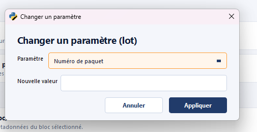
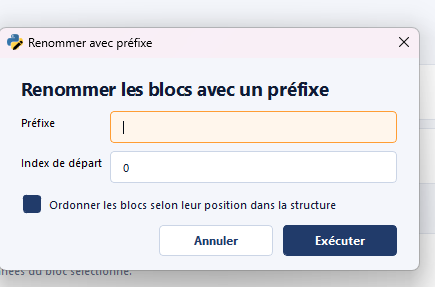
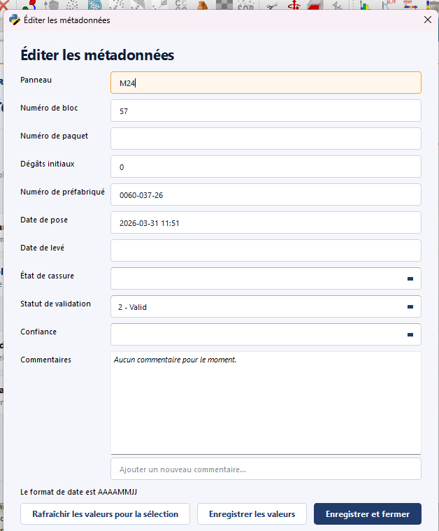
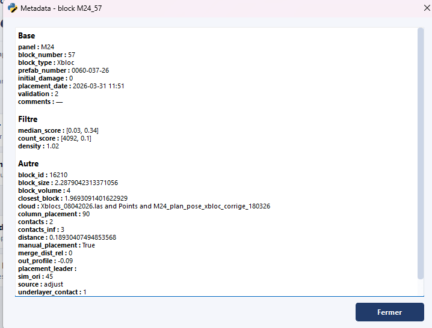

# Métadonnées

Le module **Métadonnées** regroupe les outils d'**édition des métadonnées
des blocs** : changement de valeur d'un paramètre, renumérotation, et
consultation / édition fine d'un bloc unitaire.

Les 5 actions sont réparties en trois catégories :

- **Lot** : agit sur tous les blocs actuellement sélectionnés dans la
  scène CloudCompare.
- **Bloc** : agit sur le bloc unique sélectionné.
- **Statistiques** : décompte en lecture seule, sur la sélection ou toute la scène.

## Changer un paramètre (lot) { #change-parameter-batch }

**Catégorie : Lot**

Met à jour un **paramètre unique** sur tous les blocs sélectionnés en une
seule opération. Utile pour homogénéiser un champ (par exemple
`block_type`, `package`, ou tout autre attribut métadonnée) sur une zone
entière.

!!! warning "Action destructive"
L'opération écrase la valeur précédente sur tous les blocs concernés.
Sauvegarder (action [`Sauvegarder un JSON`](output.md#save-json))
avant un traitement massif, et utiliser [`Annuler la dernière action`](header.md#undo) si besoin de revenir en arrière.

## Renommer les blocs avec un préfixe (lot) { #rename-blocks-with-prefix-batch }

**Catégorie : Lot**

Applique un **préfixe** à la sélection et **réindexe** les blocs derrière
ce préfixe. C'est l'opération de **renommage par lot** utilisée typiquement
en fin de traitement pour produire une nomenclature finale propre avant
le rendu de livraison.

Exemple : `B-0001`, `B-0002`, … pour tous les blocs sélectionnés, où `B-`
est le préfixe et `0001`, `0002`… est l'index séquentiel.

!!! note "Préalable au rendu final"
Cette action est citée dans la [procédure courante](../workflow/procedure-courante.md#final-render)
comme étape de **réindexation** précédant l'action [`Exporter le rendu final`](output.md#export-final-render). Elle garantit que la
numérotation finale est continue et sans trou.

## Éditeur de métadonnées (bloc) { #metadata-editor-block }

**Catégorie : Bloc**

Ouvre un éditeur permettant de **modifier n'importe quel champ
métadonnée** du bloc sélectionné. Là où [`Changer un paramètre
(lot)`](#change-parameter-batch) cible un champ à la fois sur N blocs,
cette action cible N champs à la fois sur un seul bloc.

L'éditeur expose aussi un sélecteur **`Validation status`** qui fixe l'état
de validation du bloc parmi trois valeurs :

- **Invalid** (`0`) — bloc rejeté.
- **Pending** (`1`) — en attente de contrôle.
- **Valid** (`2`) — bloc validé.

Ce statut est partagé avec le cloud-viewer et exploité pour le suivi de la
revue qualité.

### Journal de commentaires { #comments-log }

Le champ **`Comments`** tient un journal horodaté par bloc. Chaque entrée
porte sa date, son auteur et son type : un commentaire libre, ou un événement
d'audit écrit automatiquement à chaque changement de `Validation status`.

- **Publier** : saisir le texte, puis cliquer sur **`Send`** ou appuyer sur
  ++enter++. Le commentaire est écrit aussitôt, sans passer par
  `Save values`. Un texte laissé dans le champ n'est pas un commentaire : il
  est abandonné au changement de bloc, avec un avertissement.
- **Modifier** : l'icône ✎ d'une entrée rouvre son texte. La date et l'auteur
  d'origine sont conservés.
- **Supprimer** : l'icône × retire l'entrée, après confirmation.

Les événements d'audit de validation ne portent ni ✎ ni × : ils tracent
l'historique des statuts et ne sont pas retouchables.

### Auteur des commentaires { #comment-author }

Au premier envoi, une fenêtre demande le **nom à afficher** comme auteur. Il
est mémorisé dans les préférences (paramètre `comment_author`, modifiable à
tout moment par ++ctrl++,) et sert aussi aux événements d'audit de
validation. Renoncer à se nommer annule l'envoi.

Ce nom est déclaratif : il identifie l'opérateur, il ne l'authentifie pas.
Chacun peut modifier ou supprimer les commentaires de tous.

## Afficher les métadonnées (bloc) { #show-metadata-block }

**Catégorie : Bloc · Raccourci : ++ctrl+m++**

Affiche en lecture seule les métadonnées du bloc sélectionné, **regroupées
par catégorie** (`Base`, `Filtre`, `Autre`). Action
de consultation rapide sans risque de modification.

## Comptage des blocs { #block-counts }

**Catégorie : Statistiques**

Compte les blocs **par type**, **par package** et **par plot**, plus un onglet
**par JSON** (dossier de premier niveau du DB tree créé par
[`Charger un JSON`](input.md#load-json)).

- **Rien de sélectionné** : tous les JSON de la scène.
- **Un ou plusieurs dossiers JSON sélectionnés** : uniquement leurs blocs. On
  peut aussi sélectionner un groupe de panneau ou quelques blocs.

Chaque tableau somme au total affiché en tête : les blocs sans valeur sont
comptés sur la ligne `(non renseigné)`. Un clic sur l'en-tête d'une colonne
trie par valeur ou par effectif. L'action ne modifie rien.
