# Prise en main de CloudCompare

CloudCompare est un logiciel libre de visualisation 3D. SEABIM Editor est un
plugin Python qui s'utilise depuis l'interface de CloudCompare.

Téléchargement de CloudCompare : <https://www.danielgm.net/cc/release/> (voir
aussi la page [Installation](../demarrage/installation.md)).

## Interface générale { #interface }

L'interface de CloudCompare se divise en plusieurs fenêtres :

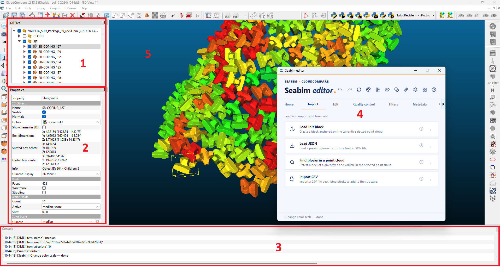

1. **Arborescence (DB Tree)** : l'ensemble des données chargées dans la
   session de travail `.bin`, organisées en dossiers et en couches. **Chaque
   couche cochée apparaît dans la vue 3D.** La flèche à gauche d'un nom déplie
   le dossier ou la couche pour en afficher le contenu.
2. **Propriétés** de la couche sélectionnée : c'est ici que l'on change le
   champ scalaire affiché d'un modèle 3D, que l'on passe un nuage de points de
   l'affichage **RGB** à l'affichage **champ scalaire**, et que l'on affiche ou
   modifie l'échelle de couleurs.
3. **Console** des actions en cours ou passées. Elle permet de suivre les
   étapes d'une fonction : chaque fonction lancée doit se terminer par
   `Process finished`. En cas d'erreur, le problème y est affiché.
4. **Launcher SEABIM Editor**, qui donne accès aux fonctions du plugin (voir
   [Interface](../demarrage/interface.md)). Il s'ouvre avec l'icône
   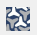{ .off-glb }
   de la barre d'outils des plugins, à droite.
5. **Vue 3D** principale, dans laquelle on se déplace et on zoome.

!!! note "Fluidité de l'affichage"
    Plus le projet contient de données, plus il est lourd et moins la
    navigation est fluide. La vue 3D peut ralentir si trop de couches sont
    cochées : **décocher** celles qui ne servent pas à l'analyse ou qui sont
    hors de la zone d'étude.

## Importer un nuage de points { #import }

Pour importer un nuage de points, glisser-déposer le fichier dans la fenêtre
principale de CloudCompare.

### Système de coordonnées et offset { #offset }

CloudCompare **ne gère pas** les systèmes de coordonnées ni la reprojection.
Les coordonnées XY du nuage doivent donc être projetées dans un référentiel
planimétrique propre au projet et exprimées en mètres (éventuellement en cm ou
en mm pour un modèle physique en laboratoire). Des coordonnées en latitude et
longitude, en degrés, ne sont pas interprétées.

Pour manipuler moins de chiffres significatifs, CloudCompare propose à
l'import un **offset** (`Global shift`) qui rapproche le nuage de l'origine du
référentiel. Sans offset, ou avec un offset qui ne réduit pas assez le nombre
de chiffres significatifs, le nuage peut présenter des déformations à
l'affichage.

- L'offset suggéré **peut être ajusté** par l'opérateur.
- Il est défini à l'import du premier nuage et **doit être réappliqué à
  l'identique** à l'import de chaque nouveau nuage : avec un offset différent,
  le second nuage est décalé par rapport au premier.
- Il est recommandé de n'appliquer un offset qu'en **XY**, et pas en Z, pour
  éviter toute confusion.

**Il y a donc un offset par projet.**

!!! note "Offset et export"
    CloudCompare crée ainsi un référentiel local proche de l'origine. L'offset
    est enregistré pour chaque couche du projet et réappliqué automatiquement
    à l'export. Un nommage détaillé des couches permet de savoir dans quel
    système de coordonnées et avec quelle référence altimétrique chacune est
    exprimée.

### Se déplacer dans la vue 3D { #navigation }

| Geste                      | Effet                                                         |
| -------------------------- | ------------------------------------------------------------- |
| Clic droit maintenu        | Déplacement dans le plan de l'écran (haut, bas, gauche, droite). |
| Clic gauche maintenu       | Rotation autour du point d'ancrage.                           |
| Double clic sur un élément | Définit le point d'ancrage de la rotation.                    |
| Molette                    | Zoom avant et arrière.                                        |

### Sous-échantillonner { #sampling }

Pour plus de fluidité, il est recommandé de sous-échantillonner à **0,02 m**
les nuages photogrammétriques très denses. L'outil d'échantillonnage est
accessible une fois le nuage sélectionné :

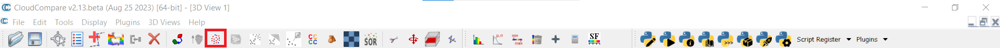

## Fonctions courantes { #common-functions }

Principales fonctions de CloudCompare utilisées sur un projet SEABIM :

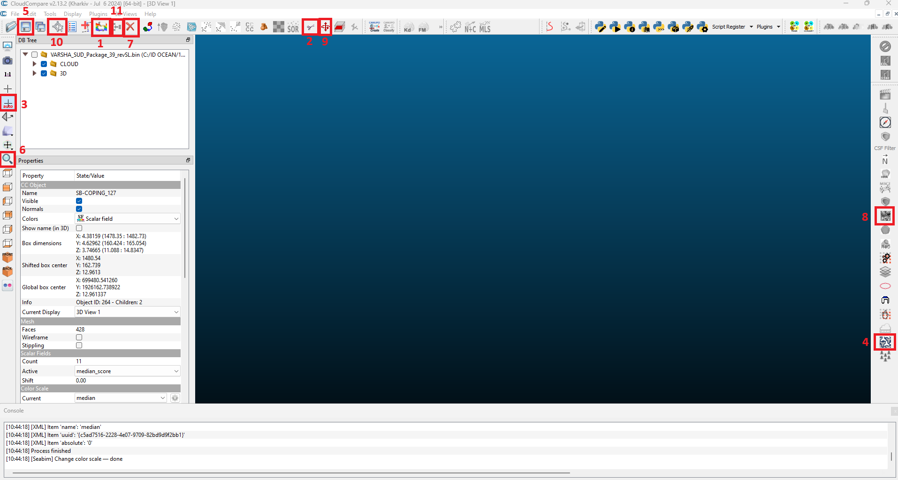

| N° | Icône | Fonction | Rôle |
| -- | ----- | -------- | ---- |
| 1  | 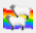{ .off-glb } | Clone | Duplique la sélection. |
| 2  | 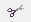{ .off-glb } | Ciseau (`Segment`) | Découpe des zones du nuage de points, pour appliquer des traitements différents selon les zones ou alléger le projet en retirant les données hors de la zone de travail. |
| 3  | 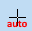{ .off-glb } | `Auto-pick rotation center` | Place le centre de rotation au centre de la vue. |
| 4  | { .off-glb } | SEABIM Editor | Ouvre le launcher SEABIM Editor. |
| 5  | 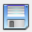{ .off-glb } | Sauvegarder | Sauvegarde la sélection : sélectionner le dossier racine pour sauvegarder toute la session de travail (voir [Fichiers CloudCompare BIN](formats-fichiers.md#fichiers-cloudcompare-bin)). |
| 6  | { .off-glb } | Zoom | Zoome sur la sélection. |
| 7  | { .off-glb } | Supprimer | Supprime **définitivement** la sélection. Pour des blocs, préférer la [`Suppression sécurisée`](../modules/edit.md#safe-delete), qui s'annule. |
| 8  | 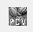{ .off-glb } | PCV | Calcule l'ombrage PCV du nuage de points sélectionné. |
| 9  | 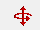{ .off-glb } | Déplacer (`Translate/Rotate`) | Déplace la sélection en X, Y et Z (voir [ci-dessous](#translate)). |
| 10 | 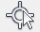{ .off-glb } | `Point picking` | Lit les informations du point sélectionné : coordonnées, valeur du champ scalaire actif (par exemple le résultat d'un filtre SEABIM). |
| 11 | { .off-glb } | Fusionner (`Merge`) | Assemble plusieurs lots de données, par exemple pour réassembler avant un rendu final les nuages découpés par zone. |

### Déplacer la sélection { #translate }

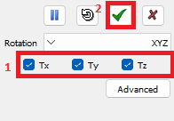

- La barre ++space++ met le déplacement en pause, le temps de changer de point
  de vue pour ajuster la position.
- Pour plus de précision, un axe peut être verrouillé (**1**).
- Le déplacement n'est pris en compte qu'après validation par la coche verte
  de la fenêtre (**2**).

## Raccourcis utiles { #shortcuts }

| Touche                              | Effet                                                    |
| ----------------------------------- | -------------------------------------------------------- |
| ++a++                               | Active ou désactive la sélection dans l'arborescence.    |
| ++v++                               | Affiche ou masque la sélection.                          |
| ++d++                               | Affiche ou masque le nom des entités dans la vue 3D.     |
| ++z++                               | Zoome et centre la vue sur la sélection (un bloc par exemple). |
| ++e++                               | Exporte les informations de la sélection en CSV.         |
| ++s++                               | Active ou désactive l'affichage du champ scalaire.       |
| ++t++                               | Ciseau (découpe).                                        |
| ++del++                             | Supprime la couche sélectionnée.                         |
| ++alt++ + clic gauche maintenu      | Dessine un rectangle de sélection multiple.              |

Un bloc sélectionné dans la vue 3D est automatiquement sélectionné dans
l'arborescence.

Les raccourcis propres à SEABIM Editor sont listés sur la page
[Raccourcis clavier](../reference/raccourcis.md).

!!! note "Pour aller plus loin"
    Site de CloudCompare : <https://www.danielgm.net/cc/>
