# Cheminement d'un projet-type

Cette page présente les étapes d'un projet type de reconstruction 3D, du nuage
de points aux rendus clients, et les subtilités fréquemment rencontrées. Elle
sert aussi de guide pour un premier projet.

## 1. Lancer CloudCompare puis SEABIM Editor { #launch }

Au lancement de CloudCompare, un logo « SEABIM » s'affiche et témoigne du bon
démarrage de SEABIM Editor. Ouvrir ensuite le launcher avec l'icône SEABIM de
la barre d'outils des plugins :

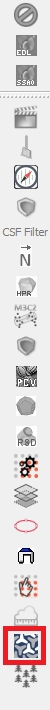

La licence est vérifiée à l'ouverture du launcher. Si le poste n'est pas encore
activé, suivre la procédure [Activation de la
licence](../demarrage/activation-licence.md). Le launcher s'ouvre sur l'onglet
`Accueil` (voir [Interface](../demarrage/interface.md)).

## 2. Organiser le projet { #working-folder }

### 2.1. Dossier de travail

Créer l'arborescence du dossier pour rassembler dans un même répertoire tous
les éléments du projet :

- un dossier avec les données brutes ;
- un dossier pour le plan de pose ;
- un dossier, à conserver, avec la session de travail en `.bin` ;
- un dossier avec les rendus clients.

Quand l'équipe travaille sur un dossier partagé, chacun crée son projet en
local en reprenant **la même arborescence** que le dossier partagé.

!!! warning "Noms de dossiers et de fichiers"
    Pas d'espaces ni de caractères spéciaux dans les noms : voir
    [Formats de fichiers](formats-fichiers.md).

### 2.2. Sauvegarder à chaque jalon { #save }

Onglet **Export** → [`Sauvegarder un JSON`](../modules/output.md#save-json)
enregistre la structure. Sauvegarder à chaque jalon du projet, en nommant le
fichier selon la [nomenclature des structures](formats-fichiers.md#json-naming),
par exemple `2026-05-28_14.30.00_mbes_3m3_MAIN_INT_p1_find.json` :

| Jalon            | Moment                                                        |
| ---------------- | ------------------------------------------------------------- |
| `find`           | Après la détection automatique.                               |
| `filtered`       | Après le premier filtrage.                                    |
| `manual_n`       | Après chaque version `n` du traitement manuel.                |
| `manual_n_AB`    | Après le contrôle de la version `n` par `AB` (initiales).     |

Copier ensuite le JSON sur le dossier partagé. Le fichier `autosave.json`
tenu par le launcher ne remplace pas ces sauvegardes nommées.

## 3. Le nuage de points : bathymétrique, LiDAR, photogrammétrique { #point-cloud }

Pour charger un nuage de points, le glisser-déposer dans la fenêtre de
CloudCompare.

### 3.1. Offset { #offset }

CloudCompare demande un offset de projet :

- si un offset a déjà été défini pour ce projet, veiller à reprendre **le
  même** ;
- sinon, en choisir un proche de la zone de travail.

**Attention : il y a un offset par projet !** Le détail est donné dans
[Prise en main de CloudCompare](cloudcompare.md#offset).

!!! note "Retrouver l'offset d'un projet"
    Sélectionner un bloc : l'offset du projet figure sur la ligne
    `Global shift` de la fenêtre Propriétés de CloudCompare.

### 3.2. Traitement du nuage de points { #cloud-processing }

Si nécessaire, le nuage de points peut être traité pour plus de fluidité et un
meilleur affichage.

#### 3.2.1. Découper { #cutting }

Le découpage du nuage de points peut se faire par taille de blocs, par zone
géographique (linéaire, musoir, etc.) ou autre. Pour les nuages
photogrammétriques et bathymétriques :

1. découper d'abord le nuage par **taille de bloc** (volume) ;
2. puis le découper en sous-parties `p1`, `p2`, … de **500 mètres maximum**,
   pour une bonne fluidité.

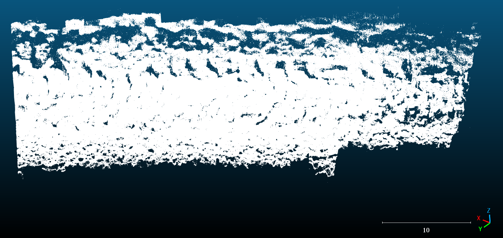

**NB :** conserver pour chaque zone le **nuage complet**, avant le découpage en
`pX` : il sert au rendu client.

!!! warning "Recouvrement obligatoire"
    Toujours garder un recouvrement entre deux nuages découpés, sinon le
    traitement peut produire des erreurs.

#### 3.2.2. Échantillonner

Pour les données photogrammétriques très denses, un ré-échantillonnage à
**2 cm (0,02 m)** est recommandé pour la fluidité de CloudCompare et le temps
de calcul de la détection automatique. Il n'est pas nécessaire de
ré-échantillonner des données bathymétriques ou LiDAR.

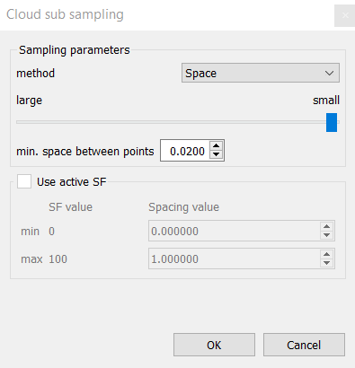

### 3.3. Affichage du nuage de points { #cloud-display }

Lancer la fonction `PCV` de CloudCompare dans la barre d'outils des plugins :

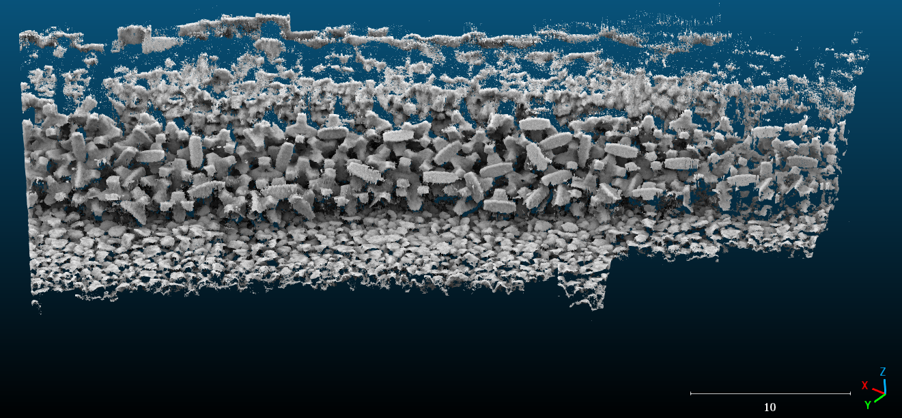

!!! note "Avant de lancer ces traitements"
    - Le nuage de points à traiter doit être **sélectionné dans le DB Tree**.
    - Respecter la nomenclature des fichiers (découpage, ré-échantillonnage,
      etc.) : voir [Formats de fichiers](formats-fichiers.md#pcd-naming).
    - Les fonctions de découpage, de fusion et d'échantillonnage sont
      détaillées dans [Prise en main de CloudCompare](cloudcompare.md#common-functions).

## 4. Modèle 3D { #model }

### 4.1. Construction d'un premier modèle 3D { #first-model }

#### 4.1.1. Détecter les blocs dans un nuage de points { #detection }

Onglet **Import** → [`Détecter les blocs dans un nuage`](../modules/input.md#find-blocks-in-a-point-cloud)
(licence BlockFinder) :

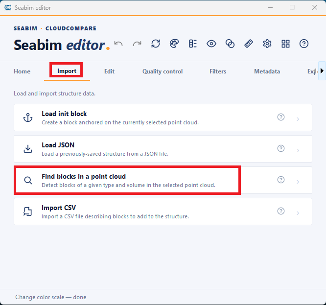

**Le type et le volume du bloc sont indispensables** pour lancer correctement
la détection.

S'il y a deux nuages de points, lancer la détection sur chacun séparément :
l'algorithme est entraîné spécifiquement pour chaque type de bloc et chaque
type de nuage, et diffère selon qu'il s'agit de photogrammétrie ou de MBES.
Plusieurs détections peuvent tourner en parallèle, dans des fenêtres
CloudCompare distinctes.

Sauvegarder le résultat (jalon `find`, voir [§ 2.2](#save)).

!!! warning "Résultat à filtrer"
    La détection trouve la vraie position de la majorité des blocs, mais
    produit aussi quelques blocs mal positionnés et en manque d'autres. Un
    filtrage et un traitement manuel sont donc nécessaires (voir
    [Traitement](#processing)).

!!! note "Taux de détection"
    Le taux de détection dépend de la qualité du nuage de points en entrée.
    Sur la base des nombreux essais réalisés sur divers projets, le taux de
    reconstruction automatique dépasse 99 % sur un bon nuage
    photogrammétrique, et 95 % sur un bon nuage bathymétrique ou LiDAR. Il est
    plus faible sur les zones de moindre qualité, comme l'interface air-eau ou
    les blocs partiellement cachés derrière des enrochements. Si le taux est
    faible sur une zone standard, vérifier la qualité du nuage de points.

#### 4.1.2. Sans détection automatique : ajouter un bloc initial

Onglet **Import** → [`Charger un bloc initial`](../modules/input.md#load-init-block) :
crée le premier bloc d'un projet.

Cette action sert quand la détection automatique n'est pas utilisée pour un
type de bloc, quand la licence n'inclut pas BlockFinder, ou pour modéliser un
bloc qui comporte peu d'entités, comme un bloc de pied de type Accroberm.

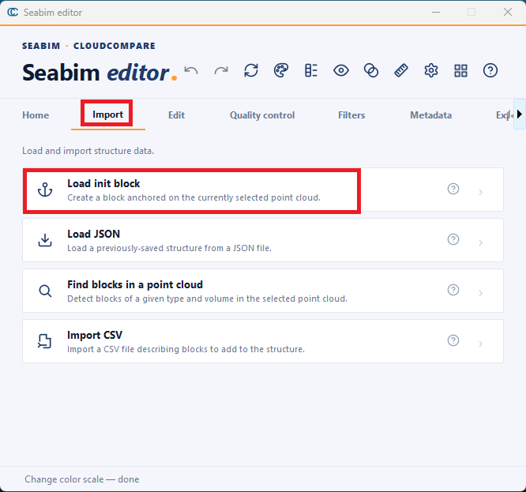

Sélectionner le nuage de points, puis renseigner le type et le volume du bloc.
Si le bloc ne se place pas au bon endroit, il faut le déplacer (voir
[Recalage](#registration)). Les blocs suivants se créent un par un, en
dupliquant un bloc existant puis en le recalant (voir
[Ajouter un bloc manquant](#add-missing-block)).

### 4.2. Import d'un modèle 3D existant { #existing-model }

#### 4.2.1. Import d'un JSON

Onglet **Import** → [`Charger un JSON`](../modules/input.md#load-json) : importe
uniquement la structure 3D d'un modèle existant.

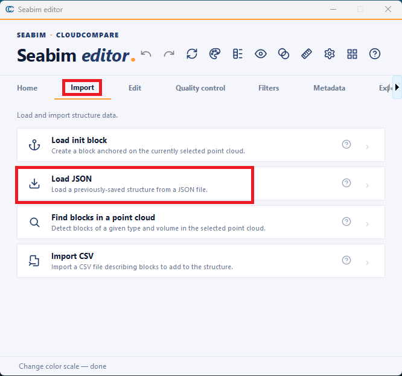

#### 4.2.2. Import d'un BIN

Toute la session de travail est importée : glisser le `.bin` directement dans
la fenêtre de CloudCompare.

### 4.3. Import d'un deuxième JSON { #merge }

Il est parfois nécessaire d'assembler des JSON, notamment si la pose de blocs
a continué dans une zone où un premier modèle a été construit : le nouveau
modèle vient alors compléter le premier.

On utilise [`Charger un JSON`](../modules/input.md#load-json). Si les zones se
recouvrent, la fenêtre **Fusionner les structures** demande comment résoudre
les conflits :

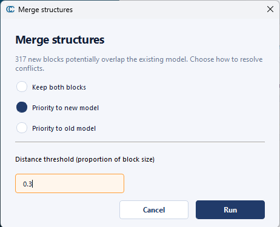

- **Garder les deux blocs** ;
- **Priorité au nouveau modèle** ;
- **Priorité à l'ancien modèle**.

Le **seuil de distance**, exprimé en proportion de la taille du bloc, fixe à
partir de quelle proximité deux blocs sont considérés comme un doublon.

!!! tip "Points d'attention"
    Faire particulièrement attention aux **interfaces entre différents
    volumes**, à la **ligne d'eau**, à la **berme** et à la **butée de pied**.

Si certains blocs ne s'affichent pas, lancer
[`Rafraîchir la vue`](../modules/header.md#update-view) (++ctrl+r++).

## 5. Nommage des blocs { #naming }

Avant le chargement du plan de pose, chaque bloc porte un numéro unique
attribué par défaut. Pour une meilleure ergonomie, il est nécessaire de
renommer les blocs.

### 5.1. Chargement du plan de pose { #placement-plan }

En chargeant le plan de pose de la zone de travail, chaque bloc est associé à
une cible et à un plot. Onglet **Édition** →
[`Trouver les noms`](../modules/edit.md#find-names) :

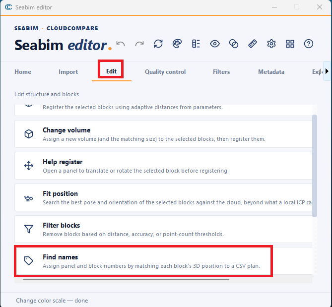

### 5.2. Sans plan de pose { #prefix-renaming }

Pour faciliter l'identification des blocs, on les renomme en leur ajoutant un
préfixe. **Sélectionner les blocs à renommer**, puis onglet **Métadonnées** →
[`Renommer les blocs avec un préfixe (lot)`](../modules/metadata.md#rename-blocks-with-prefix-batch).
On choisit alors un préfixe (par zone ou par volume, par exemple) et le début
de la numérotation :

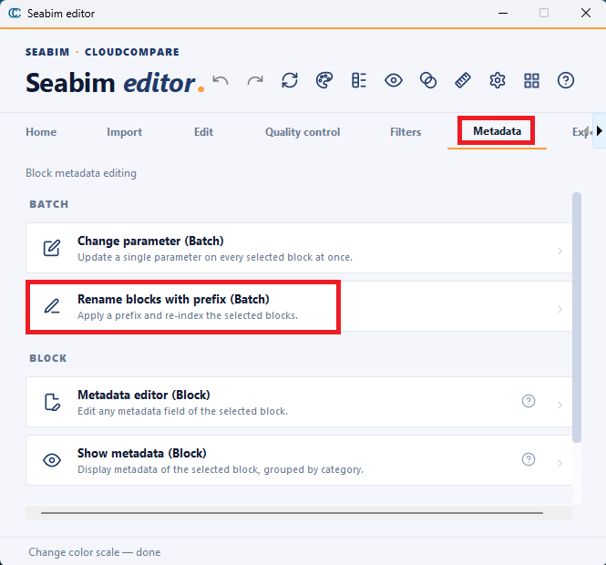

!!! warning
    Le renommage remplace le panneau et le numéro de bloc : ne pas l'appliquer
    à des blocs déjà nommés par un plan de pose.

**NB :** pour ranger les blocs par nom, sélectionner le dossier qui contient
l'ensemble des blocs, puis clic droit → `Sort children by name (A-Z)`.

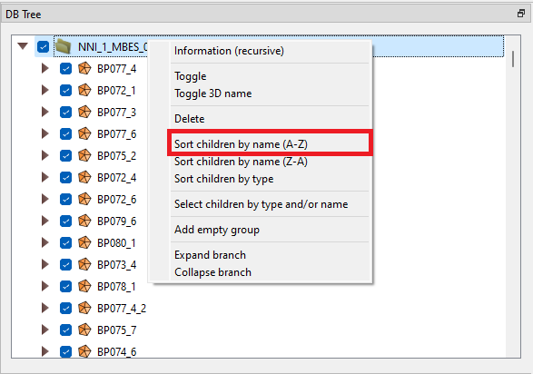

## 6. Traitement { #processing }

À l'issue de la détection automatique, la structure peut contenir des blocs
vrais mais aussi des blocs faux. Les filtres de contrôle qualité permettent de
les mettre en évidence.

### 6.1. Repérer les blocs faux ou mal recalés { #spot-errors }

Après une détection ou un recalage, les actions du module
[Contrôle qualité](../modules/quality.md) vérifient la cohérence et la
fiabilité du modèle.

- [`Recouvrement`](../modules/quality.md#overlap) et
  [`Vérification des doublons`](../modules/quality.md#check-for-duplicates)
  (distance au plus proche voisin) mettent en évidence les blocs faux :
  chevauchements et doublons.

    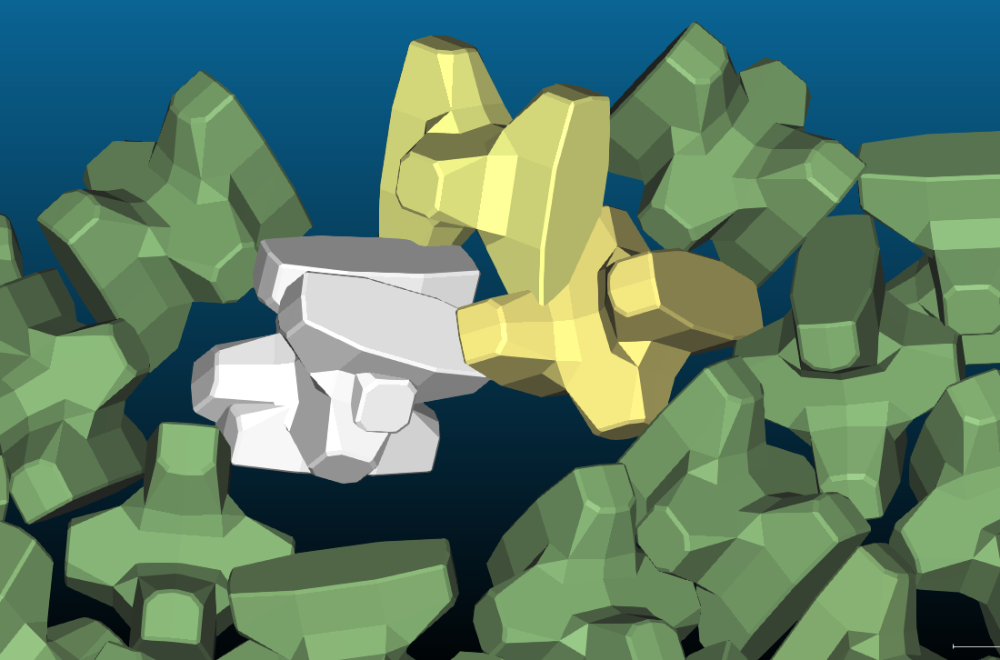

    *Le recouvrement met en évidence les blocs mal placés qui se rentrent
    dedans.*

    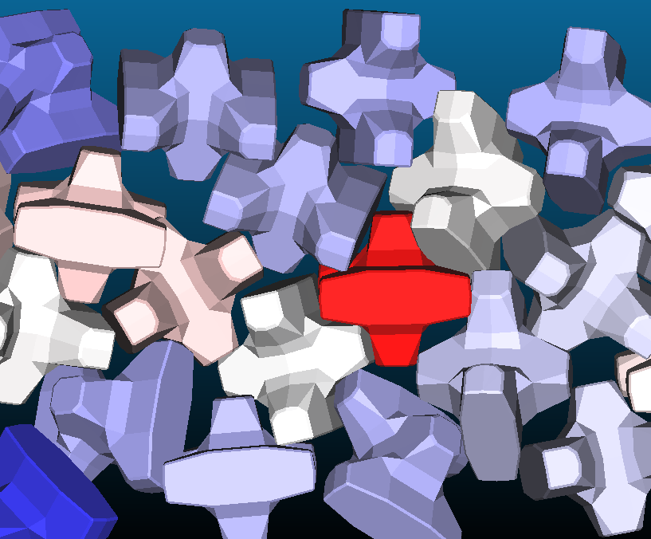

    *La vérification des doublons met en évidence les blocs à forte densité
    locale, souvent des doublons.*

- [`Calculer la précision`](../modules/quality.md#compute-accuracy) et
  [`Calculer le différentiel`](../modules/quality.md#compute-differential)
  (en affichant bien le nuage de points concerné) identifient les blocs peu
  fiables, donc mal recalés, qui demandent une attention particulière.

    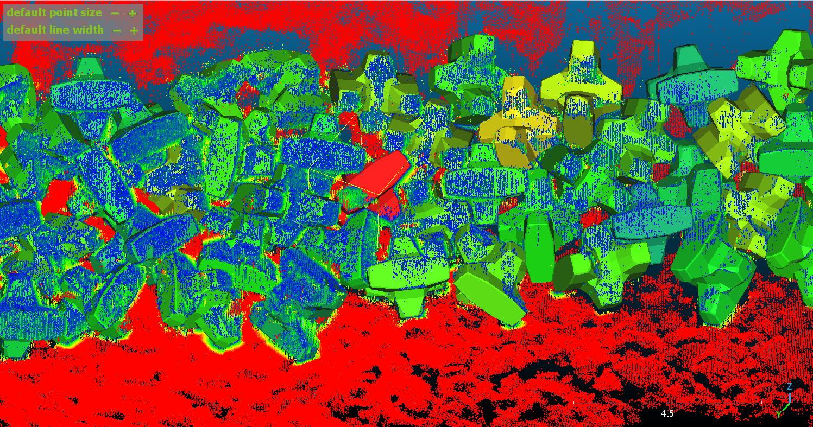

    *Ici, la précision et le différentiel mettent en évidence les blocs mal
    recalés.*

!!! note
    Lorsqu'on applique ces filtres, il est intéressant de garder le modèle 3D
    affiché derrière pour bien visualiser les défauts.

**Les erreurs récurrentes :**

- doublons lors de la fusion de deux modèles ayant une zone de recouvrement ;
- faux blocs issus de la détection automatique ;
- petit et grand côtés inversés au recalage des Accropode™ II.

### 6.2. Supprimer les blocs faux { #remove-false-blocks }

#### 6.2.1. Filtrage manuel

Les blocs faux mis en évidence par le contrôle qualité peuvent être supprimés
à la main :

- [`Suppression sécurisée`](../modules/edit.md#safe-delete) (++ctrl+d++) :
  supprime les blocs sélectionnés en conservant un point d'annulation ;
  [`Annuler la dernière action`](../modules/header.md#undo) (++ctrl+z++) les
  restaure si nécessaire.
- La suppression directe dans CloudCompare (touche ++del++) est
  **définitive** : pas de retour en arrière possible.

#### 6.2.2. Filtrage automatique

Juste après une détection, un premier filtrage élimine la plupart des faux
blocs. Onglet **Édition** → [`Filtrer les blocs`](../modules/edit.md#filter-blocks) :

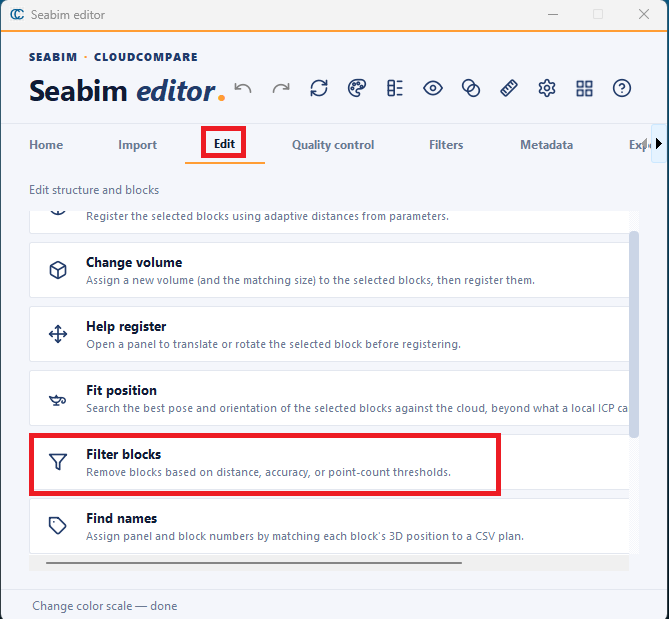

Trois critères, activables séparément, trient rapidement les blocs vrais et
faux :

- **Distance** : supprime les blocs qui se chevauchent à une distance
  inférieure au seuil ;
- **Précision** : supprime les blocs peu précis, selon leur score médian ;
- **Nombre de points** : supprime les blocs construits sur trop peu de points.

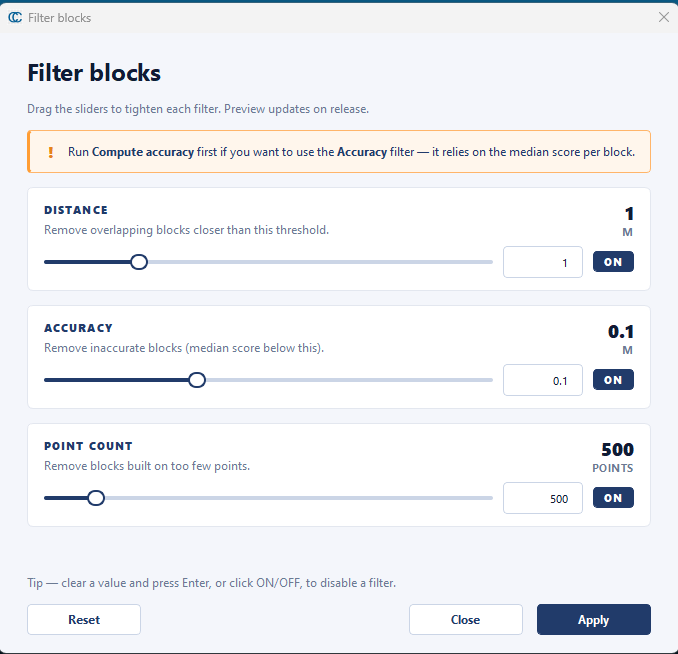

Le critère **Précision** suppose d'avoir lancé
[`Calculer la précision`](../modules/quality.md#compute-accuracy) au préalable.
Le filtrage ne supprime pas définitivement les blocs : il s'annule avec
[`Annuler la dernière action`](../modules/header.md#undo) (++ctrl+z++).

Sauvegarder le résultat (jalon `filtered`, voir [§ 2.2](#save)).

### 6.3. Ajouter un bloc manquant { #add-missing-block }

1. Sélectionner un bloc existant proche du bloc manquant.
2. Le dupliquer avec la fonction `Clone` de CloudCompare.
3. Le déplacer au plus près de la position supposée (bien valider à la fin du
   déplacement).
4. Le recaler avec [`Recaler la sélection`](../modules/edit.md#register-selection---adaptive-dist)
   (++ctrl+e++), voir [Recalage](#registration).

Les fonctions de base de CloudCompare (clone, déplacement, etc.) sont
rappelées dans [Prise en main de CloudCompare](cloudcompare.md#common-functions).

Si le bloc existe sur l'ouvrage mais ne peut pas être modélisé depuis le nuage,
utiliser plutôt [`Marquer un bloc manquant`](../modules/edit.md#mark-missing-block).

### 6.4. Recalage { #registration }

Pour recaler des blocs trouvés par la détection, repris ou ajoutés à la main :

1. Sélectionner le bloc et utiliser la fonction de déplacement de CloudCompare.
2. Placer le bloc au plus près de la position supposée et valider la position
   dans la fenêtre de déplacement :

    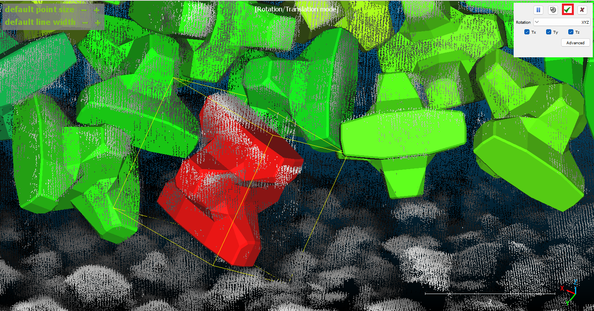

    Pendant le déplacement, la barre ++space++ met le bloc en pause, le temps
    de changer d'angle de vue pour un meilleur placement.

3. Lancer [`Recaler la sélection`](../modules/edit.md#register-selection---adaptive-dist)
   (++ctrl+e++). À l'issue du recalage, le bloc prend une couleur qui traduit
   la précision du recalage, du rouge au vert :

    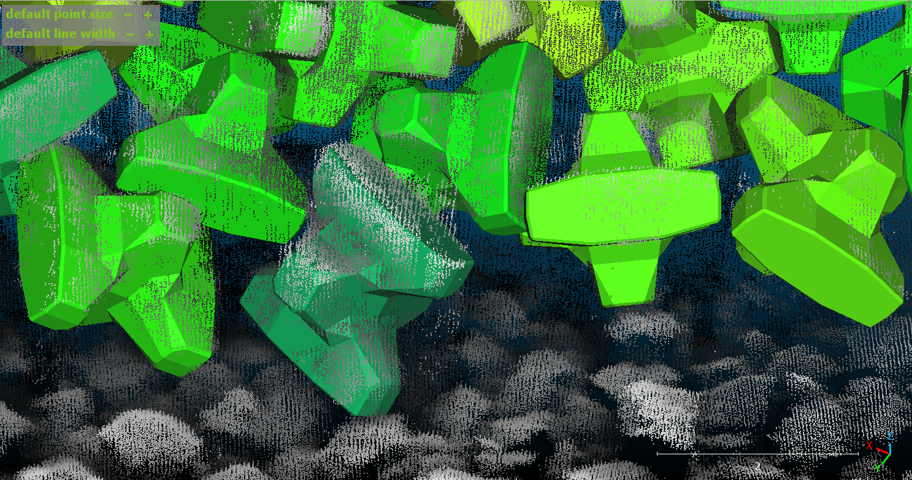

    *Ici, le bloc est devenu vert foncé : bon recalage.*

Si le nuage de points est bruité, le mode **Distance personnalisée** de
[`Recaler la sélection`](../modules/edit.md#modes-de-recalage) force une
distance maximale entre le bloc et le nuage. Le bloc doit alors être déplacé
au préalable à sa position exacte.

Variante : [`Aider le recalage`](../modules/edit.md#help-register) ouvre un
panneau pour translater ou tourner le bloc sélectionné, puis le recale à la
validation. Si un bloc reste mal placé, le retirer avec la
[`Suppression sécurisée`](../modules/edit.md#safe-delete).

!!! warning
    N'ajouter des blocs que lorsque la position est sûre.

## 7. Contrôle qualité { #quality-control }

Pour reconstruire correctement un modèle 3D, il est important d'effectuer le
contrôle qualité. Comme détaillé plus haut, chaque filtre a son rôle.

### 7.1. Calculer la précision { #accuracy }

[`Calculer la précision`](../modules/quality.md#compute-accuracy) donne
d'abord une idée de la précision du recalage par rapport au nuage de points.
Les blocs qui ressortent en rouge et en jaune nécessitent un recalage
supplémentaire.

Lorsque le nuage de points est bruité ou de moins bonne qualité, la précision
baisse : des blocs de la ligne d'eau ressortent alors.

### 7.2. Calculer le différentiel { #differential }

[`Calculer le différentiel`](../modules/quality.md#compute-differential) met
en évidence les différences entre le modèle 3D recalé et le nuage de points.
Les zones qui ressortent en jaune ou en rouge traduisent un problème et
peuvent être recalées (souvent des appendices mal identifiés, ou des grands et
petits côtés inversés sur les Accropode™ II).

!!! note
    Masquer le modèle 3D pour bien voir les zones qui ressortent en rouge et
    en jaune.

### 7.3. Vérification des doublons { #duplicates }

[`Vérification des doublons`](../modules/quality.md#check-for-duplicates)
calcule la distance de chaque bloc à son plus proche voisin. Un bloc rouge
signale un doublon potentiel. Pour le vérifier, jouer sur l'affichage de la
sélection : sélectionner le bloc puis appuyer sur ++a++ ou ++v++. Si un bloc
reste visible, c'est un doublon : on peut en supprimer un.

### 7.4. Recouvrement { #overlap }

[`Recouvrement`](../modules/quality.md#overlap) identifie les blocs qui se
chevauchent. Ils demandent une attention particulière, car ils traduisent un
mauvais recalage, ou une casse et donc un mouvement dans la zone.

Le module [Contrôle qualité](../modules/quality.md) détaille ces actions.

Une fois la version contrôlée, la sauvegarder (jalon `manual_n_AB`, voir
[§ 2.2](#save)). Si des corrections restent à faire, elles partent dans une
nouvelle version `manual_n+1`.

## 8. Filtres d'analyse { #filters }

Pour l'analyse et le suivi des ouvrages, certaines zones peuvent être plus
exposées ou plus sensibles que d'autres, et évoluer avec le temps (tassement,
tempête, etc.). Les filtres de SEABIM Editor sont une aide à l'analyse et au
contrôle : ils mettent ces zones en évidence, identifient les points d'intérêt
et facilitent l'analyse par un spécialiste.

!!! warning "Une aide à l'analyse"
    Ce ne sont que des outils de calcul et d'aide à l'analyse : ils donnent
    une tendance, mais ne permettent en aucun cas de conclure de façon ferme
    et définitive sur la conformité ou non d'une zone.

### 8.1. Paramètres des filtres { #filter-parameters }

Les paramètres des filtres se modifient dans
[`Paramètres`](../modules/header.md#settings) (++ctrl++,). On y change par
exemple la tolérance attendue pour un hors-profil ou pour le calcul des
aérations.

### 8.2. Résultats des filtres { #filter-results }

Les filtres du module [Filtres](../modules/filters.md) génèrent des champs
scalaires. Le résultat s'affiche sur le modèle 3D à la fin du calcul,
s'enregistre dans les métadonnées de chaque bloc et peut être revisualisé :

- avec [`Changer l'échelle de couleurs`](../modules/header.md#change-color-scale)
  (++ctrl+l++), qui permet aussi d'adapter l'échelle de couleurs de chaque
  filtre au projet. Cocher **Enregistrer comme défaut pour ce champ
  scalaire** conserve la modification sur le poste ;
- dans la fenêtre Propriétés de CloudCompare, rubrique `Scalar Fields` : la
  flèche de droite ouvre la liste des champs scalaires de la sélection. Cela
  ne fonctionne que pour un bloc sélectionné seul dans une session de
  travail ;

    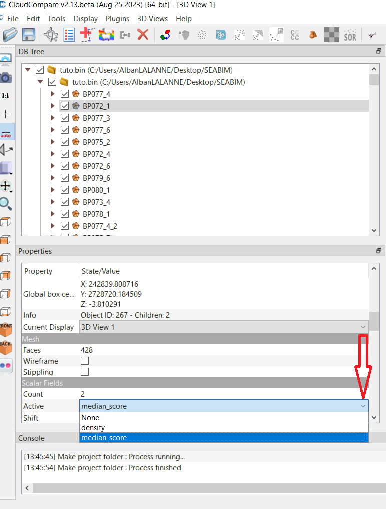

- dans le rendu final, en changeant l'affichage du modèle 3D complet dans la
  fenêtre Propriétés, comme ci-dessus ;
- avec [`Afficher les métadonnées (bloc)`](../modules/metadata.md#show-metadata-block)
  (++ctrl+m++), qui regroupe toutes les valeurs numériques des filtres
  appliqués.

!!! note "Vérifier la console"
    Pour confirmer qu'une fonction s'est terminée sans erreur, regarder la
    console en bas de la fenêtre CloudCompare : `Process finished` doit
    apparaître à la fin de l'opération, sinon l'erreur y est détaillée.

## 9. Assembler et vérifier { #verification }

Une fois toutes les sous-parties traitées :

1. Réassembler le projet complet : nuages de points complets et modèles des
   différentes parties (`bathy` et `photog`, différentes tailles de bloc),
   fusionnés avec [`Charger un JSON`](../modules/input.md#load-json) (voir
   [§ 4.3](#merge)).
2. Lancer sur l'ensemble le différentiel, la vérification des doublons et le
   recouvrement (voir [Contrôle qualité](#quality-control)).
3. Ajuster si nécessaire, en veillant à utiliser **le bon nuage** lors d'une
   nouvelle édition manuelle.

Faire particulièrement attention aux **interfaces entre différents volumes**,
à la **ligne d'eau**, à la **berme** et à la **butée de pied**.

## 10. Exports et rendus { #exports }

Tous les filtres doivent être lancés ou visualisés avant l'export. Sans plan de
pose, réindexer d'abord les blocs avec
[`Renommer les blocs avec un préfixe (lot)`](../modules/metadata.md#rename-blocks-with-prefix-batch)
pour obtenir une numérotation continue (voir [§ 5.2](#prefix-renaming)).

Les exports se font depuis le module [Export](../modules/output.md) :

- [`Exporter un CSV`](../modules/output.md#export-csv), en **format
  standard** : une liste de l'ensemble des blocs et des informations
  associées.
- [`Exporter un CSV`](../modules/output.md#export-csv), en **sélection
  personnalisée** : on choisit les champs à exporter (positions, filtres, nom,
  etc.).

    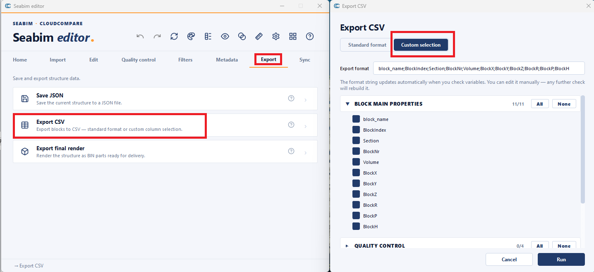

- [`Exporter le rendu final`](../modules/output.md#export-final-render) : le
  projet se visualise ensuite directement dans CloudCompare, sans SEABIM
  Editor. On choisit les informations exportées dans le rendu final :

    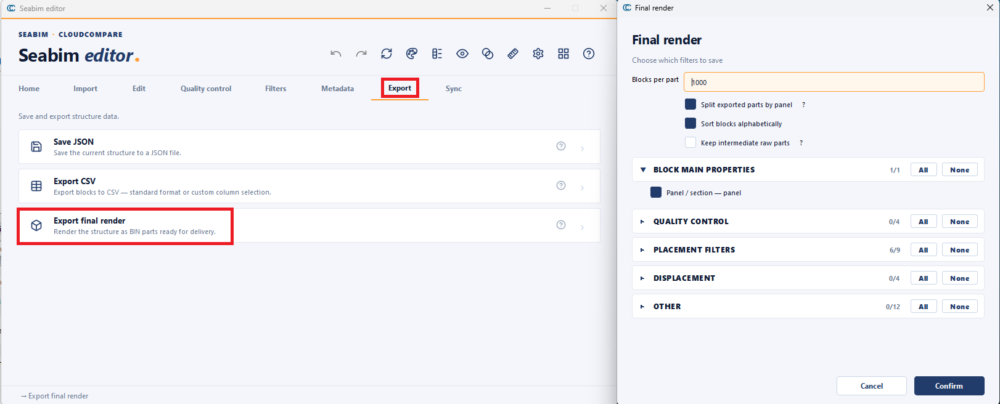

## 11. Visualisation d'un rendu final { #final-render }

Le rendu final se visualise directement dans CloudCompare, sans lancer
SEABIM Editor. Il contient :

- une section 3D :
    - le modèle 3D et les champs scalaires choisis à l'export ;
    - la couche issue du calcul des aérations ;
    - la couche issue du calcul de densité ;
    - la couche issue du calcul de déplacement ;
- le nuage de points et le différentiel associé.

Exemple :

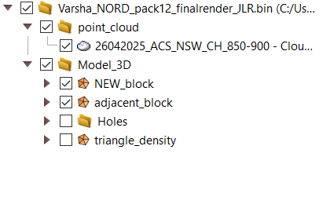

!!! note
    Pour l'export des blocs adjacents, ne pas exporter les filtres : cocher
    seulement `panel`.

Dans le rendu final, l'affichage des blocs s'applique à l'ensemble du modèle
3D : changer le champ scalaire dans la fenêtre Propriétés de CloudCompare
s'applique à tout le modèle.
